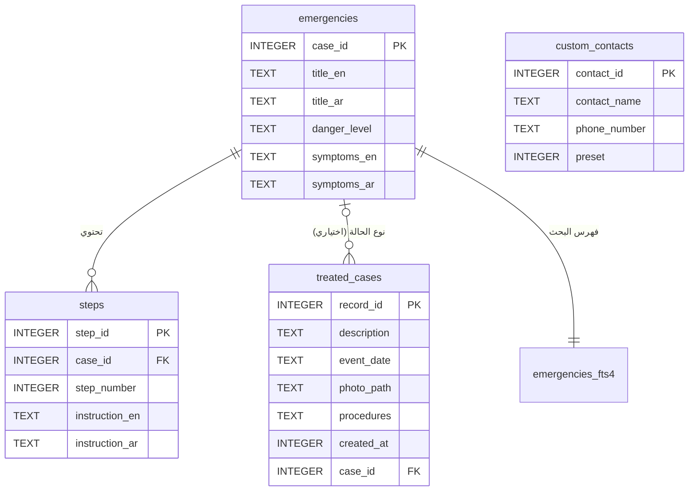

# FirstAid Hero — الدليل الشامل للمشروع

دليل واحد يشرح كل شيء في مشروع تطبيق "دليل الإسعافات الأولية للطوارئ" (FirstAid Hero): الفكرة، طريقة التشغيل، طريقة الاستخدام، شرح الكود وقاعدة البيانات، المشاكل التي واجهتنا وحلولها، ومطابقة متطلبات الوظيفة.

**المقرر:** BAIT_IWB303 — الفصل F25 · **أستاذ المقرر:** د. محمد مازن المصطفى

## المحتويات

1. الجزء الأول: نظرة عامة على المشروع
2. الجزء الثاني: التشغيل والبناء
3. الجزء الثالث: دليل الاستخدام (شاشة بشاشة)
4. الجزء الرابع: شرح الكود وقاعدة البيانات
5. الجزء الخامس: المشاكل التي واجهتنا وكيف حللناها
6. الجزء السادس: مطابقة متطلبات الوظيفة
7. الجزء السابع: الحدود والملاحظات

---

# الجزء الأول: نظرة عامة على المشروع

## 1.1 الفكرة والهدف

تطبيق أندرويد طبي خدمي يعمل **دون إنترنت تماماً**، يقدم إرشادات إسعاف أولي سريعة وواضحة لحالات الطوارئ الشائعة (الحروق، الكسور، الغرق، النوبات القلبية وغيرها). الفكرة الأساسية أن ثواني التأخير قد تعرّض حياة إنسان للخطر، لذلك صُمم التطبيق ليصل المستخدم إلى الخطوات الصحيحة بأقل عدد من الضغطات، حتى في مكان بلا تغطية.

## 1.2 المزايا الرئيسية

| الميزة | الوصف |
|---|---|
| يعمل دون إنترنت | كل البيانات في قاعدة SQLite على الجهاز، ولا يطلب التطبيق إذن الإنترنت أصلاً |
| قاعدة بيانات جاهزة | تُشحن داخل التطبيق في مجلد `assets` وتُنسخ عند أول تشغيل |
| بحث فوري | النتائج تتحدث مع كل حرف، بالعربية والإنجليزية، باستخدام `LIKE` و `MATCH` |
| خطوات مرقمة بخط كبير | 8 حالات إسعافية، لكل منها 3 خطوات مرتبة |
| اتصال سريع | زر ثابت أسفل شاشة الخطوات للاتصال المباشر بأرقام الطوارئ المخزنة |
| أرقام الطوارئ | أرقام عامة (شرطة، إسعاف، إطفاء) + أرقام المستخدم الخاصة مع إضافة وتعديل وحذف |
| سجل الحالات المعالجة | وصف، تاريخ، صورة، إجراءات، ونوع الحالة، مع بحث وتعديل وحذف |
| الإحصاءات | تصنيف الحالات حسب الخطورة وتوزيع الحالات المعالجة حسب الشهر |
| لغتان ومظهران | العربية والإنجليزية (مع اتجاه من اليمين لليسار)، ووضع فاتح وداكن |

## 1.3 التقنيات المستخدمة

| العنصر | الاختيار |
|---|---|
| بيئة التطوير | Android Studio |
| اللغة | Java 11 |
| أدنى إصدار أندرويد | Android 11 (API 30)، والإصدار المستهدف API 36 |
| قاعدة البيانات | SQLite محلية عبر `SQLiteOpenHelper`، مع جدول بحث نصي FTS4 |
| المكتبات | AndroidX AppCompat، AndroidX Activity، Material Components |
| توليد القاعدة الجاهزة | سكربت Python (`tools/generate_assets_db.py`) |

## 1.4 هيكل مجلدات المشروع

```text
IWB303/
├── app/
│   ├── build.gradle.kts                  إعدادات التطبيق والمكتبات
│   └── src/main/
│       ├── AndroidManifest.xml           الشاشات والصلاحيات
│       ├── assets/databases/
│       │   └── firstaid_hero.db          قاعدة البيانات الجاهزة
│       ├── java/com/firstaidhero/app/    كود Java (core, data, ui)
│       └── res/                          الأيقونات والقوائم والألوان والنصوص
├── tools/
│   └── generate_assets_db.py             سكربت توليد قاعدة البيانات الجاهزة
├── docs/                                 ملفات التوثيق
└── report/                               التقرير التأملي والصور
```

---

# الجزء الثاني: التشغيل والبناء

## 2.1 المتطلبات

- Android Studio (حديث) مع Android SDK 36.
- محاكي أندرويد (Android 11 فما فوق) أو جهاز حقيقي.
- Python 3 (فقط إذا أردت إعادة توليد قاعدة البيانات الجاهزة).

## 2.2 تشغيل التطبيق

1. افتح مجلد المشروع `IWB303` في Android Studio وانتظر انتهاء مزامنة Gradle.
2. اختر المحاكي أو الجهاز من شريط الأدوات.
3. اضغط زر **Run** (المثلث الأخضر). يُبنى التطبيق ويُثبَّت ويفتح تلقائياً.
4. ملف التثبيت الناتج يكون في `app/build/outputs/apk/debug/app-debug.apk`.

## 2.3 تعديل محتوى الحالات الإسعافية

1. عدّل القائمة `CASES` في `tools/generate_assets_db.py`، وعدّل `SEED_CASES` و `SEED_STEPS` في `DatabaseHelper.java` بالشكل نفسه.
2. شغّل: `python tools/generate_assets_db.py` لإعادة توليد `firstaid_hero.db`.
3. ارفع رقم الإصدار `DB_VERSION` في الكود و `user_version` في السكربت معاً، وأضف خطوة في `onUpgrade` (عادة `seedEmergencyContent(db); rebuildFts(db);`) حتى يحصل المستخدمون الحاليون على المحتوى الجديد.

## 2.4 اختبار سريع بعد التشغيل

| الاختبار | النتيجة المتوقعة |
|---|---|
| تشغيل التطبيق مع إيقاف الإنترنت | كل الشاشات تعمل |
| كتابة "لدغ" في البحث | تظهر "لدغات الأفاعي والحشرات" |
| كتابة `sna ins` | تظهر "Snake or insect bite" (بفضل MATCH) |
| فتح حالة | خطوات مرقمة بخط كبير وزر اتصال ثابت أسفل الشاشة |
| إضافة رقم برقم خاطئ مثل `abc` | رسالة خطأ بجانب الحقل والنافذة تبقى مفتوحة |
| تسجيل حالة معالجة مع صورة ثم تدوير الشاشة | لا يضيع شيء من النموذج |
| فتح شاشة الإحصاءات | 4 حرجة، 3 متوسطة، 1 طفيفة لحالات الدليل |

## 2.5 إعادة توليد التقرير بعد إضافة لقطات الشاشة

1. ضع لقطات الشاشة في `report/screenshots/` بالأسماء المكتوبة داخل أماكنها في التقرير (مثل `01_splash.png` و `04_search_ldg.png`).
2. من داخل المجلد `report/tools` شغّل مرة واحدة: `npm install`، ثم في كل مرة: `node build_report.js`.
3. افتح الملف الناتج في Word واضغط على فهرس المحتويات ثم F9 لتحديث أرقام الصفحات، أو شغّل `finalize.ps1` ليحدّث الفهرس ويصدّر نسخة PDF تلقائياً:
   `powershell -ExecutionPolicy Bypass -File finalize.ps1 -Docx <مسار ملف docx> -Pdf <مسار ملف pdf>`
4. لتعديل نص التقرير عدّل `report/REPORT_SOURCE_AR.md` ثم أعد التوليد.

---

# الجزء الثالث: دليل الاستخدام (شاشة بشاشة)

## 3.1 شاشة البداية والتعريف

عند أول تشغيل تظهر شاشة البداية الحمراء ثم ثلاث صفحات تعريفية (تصرف بسرعة، يعمل دون إنترنت، جهات اتصال موثوقة). يمكن تخطيها بزر "تخطي". في المرات التالية يفتح التطبيق الشاشة الرئيسية مباشرة.

## 3.2 الشاشة الرئيسية والبحث

- في الأعلى بطاقة حمراء وتحتها شريط بحث كبير.
- تحت الشريط قائمة كل الحالات مرتبة من الأخطر إلى الأقل خطورة.
- اكتب أي جزء من اسم الحالة أو أعراضها بالعربية أو الإنجليزية، فتتحدث النتائج مع كل حرف.
- اضغط على بطاقة الحالة لفتح خطواتها.

## 3.3 شاشة خطوات الإسعاف

- العنوان، شارة مستوى الخطورة، والأعراض الشائعة.
- الخطوات مرقمة (1، 2، 3) بخط كبير وواضح.
- زر "تسجيل هذه الحالة كمعالجة" يفتح نموذج السجل مع اختيار نوع الحالة تلقائياً.
- **في أسفل الشاشة** زر أحمر ثابت "اتصال سريع بأرقام الطوارئ": يعرض الأرقام المخزنة، والضغط على رقم يتصل به مباشرة. أول مرة يطلب التطبيق إذن الاتصال؛ إذا رُفض تُفتح لوحة الاتصال مع الرقم جاهزاً.

## 3.4 شاشة أرقام الطوارئ

- البطاقة الحمراء: أرقام الشرطة والإسعاف والإطفاء؛ الضغط على أي منها يتصل مباشرة. هذه الأرقام لا يمكن تعديلها أو حذفها.
- "إضافة جهة اتصال": اكتب الاسم والرقم، أو اضغط "اختيار من جهات اتصال الجهاز".
- كل رقم خاص له ثلاثة أزرار: اتصال، تعديل، حذف (مع تأكيد).

## 3.5 سجل الحالات المعالجة

- يعرض الحالات من الأحدث للأقدم، ولكل سجل: صورة مصغّرة، الوصف، التاريخ، نوع الحالة وخطورتها، والإجراءات.
- الضغط على الصورة المصغّرة يعرضها كاملة.
- حقل البحث يبحث في الوصف والإجراءات والتاريخ ونوع الحالة.
- أزرار "تعديل" و"حذف" لكل سجل.

## 3.6 شاشة إدخال حالة معالجة

1. اختر نوع الحالة (أو اتركه "غير محدد").
2. اكتب وصف الحالة (مطلوب).
3. اضغط حقل التاريخ لاختياره من التقويم (لا يُقبل تاريخ مستقبلي).
4. اكتب الإجراءات التي أُجريت (مطلوب).
5. اضغط "اختيار صورة" لاختيار صورة من الجهاز؛ تظهر معاينتها مباشرة، ويمكن تغييرها أو إزالتها.
6. اضغط "حفظ". إذا كان هناك حقل ناقص يظهر الخطأ بجانبه ولا يُغلق النموذج.

## 3.7 شاشة الإحصاءات

ثلاث بطاقات بأشرطة أفقية: حالات الدليل حسب الخطورة، الحالات المعالجة حسب الخطورة، والحالات المعالجة حسب الشهر. تتحدث تلقائياً عند العودة إليها بعد تسجيل حالة.

## 3.8 الإعدادات

اختيار اللغة (العربية / English) والمظهر (حسب الجهاز / فاتح / داكن). تُحفظ الاختيارات على الجهاز.

---

# الجزء الرابع: شرح الكود وقاعدة البيانات

> داخل ملفات الكود يوجد تعليق عربي فوق كل فئة وكل طريقة وبجانب كل مكتبة مستوردة. هذا الجزء يشرح الصورة الكاملة.

## 4.1 البنية العامة (Architecture)

- اللغة: **Java**، بيئة التطوير: **Android Studio**، أدنى إصدار أندرويد مدعوم: **API 30 (Android 11)**.
- التخزين: قاعدة **SQLite** محلية بالكامل، دون أي اتصال بالإنترنت أو بالسحابة (التطبيق لا يطلب إذن `INTERNET` أصلاً).
- الواجهات تُبنى **برمجياً بلغة Java** (دون ملفات XML للتخطيطات) عبر فئة تصميم مشتركة هي `Ui`، لضمان توحيد الألوان والخطوط ودعم الوضع الليلي واتجاه العربية (RTL).
- كل شاشة هي **Activity** مستقلة، وتتشارك الشاشات الرئيسية شريط تنقل سفلي (`BottomNavigationView`) من مكتبة Material.
- **ملاحظة حول Adapters و ViewModels:** ذكرتها الوظيفة كمثال. التطبيق لا يستخدمهما؛ القوائم (الحالات، جهات الاتصال، السجل) تُبنى مباشرة من نتيجة الاستعلام (`Cursor`) لأن حجم البيانات صغير (عشرات السجلات)، فيبقى الكود بسيطاً وسريعاً. فصل المسؤوليات يتم عبر الحزم: `core` للتفضيلات والترجمة، `data` للوصول إلى البيانات، `ui` للواجهات.

```text
com.firstaidhero.app
├── core/                         التفضيلات والترجمات
│   ├── AppPreferences.java
│   └── I18n.java
├── data/                         الوصول إلى البيانات
│   ├── DatabaseHelper.java       قاعدة البيانات وكل الاستعلامات
│   ├── DeviceContacts.java       قراءة جهات اتصال الجهاز
│   └── PhotoStore.java           حفظ صور الحالات المعالجة
└── ui/                           نظام التصميم والشاشات
    ├── Ui.java
    └── screens/
        ├── BaseActivity.java             الأب المشترك لكل الشاشات
        ├── SplashActivity.java           شاشة البداية
        ├── OnboardingActivity.java       شاشات التعريف (أول تشغيل)
        ├── MainActivity.java             الشاشة الرئيسية والبحث
        ├── EmergencyDetailActivity.java  شاشة خطوات الإسعاف
        ├── ContactsActivity.java         شاشة أرقام الطوارئ
        ├── TreatedCasesActivity.java     سجل الحالات المعالجة
        ├── TreatedCaseFormActivity.java  شاشة إدخال/تعديل حالة معالجة
        ├── StatisticsActivity.java       شاشة الإحصاءات
        └── SettingsActivity.java         الإعدادات
```

ملفات أخرى مهمة:

| الملف | الدور |
|---|---|
| `app/src/main/assets/databases/firstaid_hero.db` | قاعدة البيانات الجاهزة المسبقة الصنع التي تُشحن داخل التطبيق |
| `tools/generate_assets_db.py` | سكربت Python يولّد قاعدة البيانات الجاهزة السابقة. يُشغَّل بالأمر `python tools/generate_assets_db.py` بعد أي تعديل على المحتوى |
| `app/src/main/AndroidManifest.xml` | تعريف الشاشات والصلاحيات (`READ_CONTACTS`, `CALL_PHONE`) |
| `app/src/main/res/menu/bottom_nav.xml` | عناصر شريط التنقل السفلي الخمسة |
| `app/src/main/res/drawable/ic_*.xml` | أيقونات متجهية (Vector) للتنقل والأزرار |

---

## 4.2 حزمة core

### 4.2.1 AppPreferences.java
تحفظ إعدادات المستخدم في `SharedPreferences` داخل ملف اسمه `firstaid_hero_preferences`. كل الطرق `static`، والمُنشئ خاص (`private`) لمنع إنشاء كائن من الفئة.

| الطريقة | ماذا تفعل |
|---|---|
| `prefs(Context)` | تعيد كائن `SharedPreferences` الخاص بالتطبيق (طريقة داخلية) |
| `isOnboardingComplete(Context)` | هل أنهى المستخدم شاشات التعريف؟ (القيمة الافتراضية `false`) |
| `setOnboardingComplete(Context)` | تحفظ أن شاشات التعريف انتهت، فلا تظهر مرة أخرى |
| `isArabic(Context)` | تعيد `true` إذا كانت اللغة المحفوظة `ar` (الافتراضي `en`) |
| `setArabic(Context, boolean)` | تحفظ اللغة المختارة |
| `getThemeMode(Context)` | تعيد وضع المظهر: `system` أو `light` أو `dark`. الافتراضي `system` أي اتباع إعداد الجهاز، ولا يُحفظ شيء حتى يغيّره المستخدم |
| `setThemeMode(Context, String)` | تحفظ وضع المظهر بعد التحقق من صحته (أي قيمة غير معروفة تتحول إلى `system`) |
| `toNightMode(String)` | تحوّل النص إلى الثابت المناسب في `AppCompatDelegate` (`MODE_NIGHT_NO` / `MODE_NIGHT_YES` / `MODE_NIGHT_FOLLOW_SYSTEM`) |
| `applyDirection(Context, View)` | تضبط اتجاه الواجهة: من اليمين لليسار للعربية، ومن اليسار لليمين للإنجليزية |

### 4.2.2 I18n.java
كل نصوص الواجهة باللغتين. الطريقة الوحيدة `t(Context, key)` تستقبل مفتاحاً نصياً (مثل `"save"`) وتعيد النص بالعربية أو الإنجليزية حسب اللغة المحفوظة، باستخدام `switch`. إذا لم يوجد المفتاح تعيد المفتاح نفسه، فلا ينهار التطبيق أبداً بسبب نص ناقص. تُستخدم الطريقة نفسها أيضاً لترجمة أسماء أرقام الطوارئ الافتراضية المخزنة في قاعدة البيانات (`police`, `ambulance`, `fire`).

---

## 4.3 حزمة data

### 4.3.1 DatabaseHelper.java
الفئة الأساسية للبيانات. ترث `SQLiteOpenHelper`، وتحتوي إنشاء الجداول، نسخ القاعدة الجاهزة، الترحيلات، البحث، وكل عمليات CRUD والإحصاءات.

**الثوابت:**

| الثابت | المعنى |
|---|---|
| `DB_NAME` | اسم ملف القاعدة على الجهاز: `firstaid_hero.db` |
| `ASSET_PATH` | مسار القاعدة الجاهزة داخل `assets`: `databases/firstaid_hero.db` |
| `DB_VERSION` | رقم إصدار المخطط الحالي: **6** |
| `SEED_CASES` / `SEED_STEPS` | نسخة احتياطية من محتوى الحالات الثماني وخطواتها داخل الكود (تُستخدم إن تعذّر نسخ ملف الأصول، وفي الترحيلات) |
| `SEVERITY_ORDER` | تعبير `CASE` يرتب الخطورة: حرج ← متوسط ← طفيف ← غير محدد. يُستخدم في البحث والإحصاءات |
| `SEED_PRESET_CONTACTS` | أرقام الطوارئ الافتراضية: الشرطة 112، الإسعاف 110، الإطفاء 113 |
| `TREATED_COLUMNS` | بداية استعلام السجل مع `LEFT JOIN` على جدول الحالات (لجلب عنوان الحالة وخطورتها) |

**الطرق:**

| الطريقة | ماذا تفعل |
|---|---|
| `DatabaseHelper(Context)` | المُنشئ: يحدد الاسم والإصدار، ثم يستدعي `copyDatabaseFromAssets` |
| `copyDatabaseFromAssets(Context)` | **عند أول تشغيل فقط** (إذا لم يكن ملف القاعدة موجوداً): ينسخ القاعدة الجاهزة من `assets` إلى مجلد قواعد البيانات في النظام على دفعات من 8 كيلوبايت. إذا فُقد ملف الأصول أو تعذّرت قراءته يحذف أي ملف ناقص، فيُنشئ `onCreate` القاعدة من البيانات الاحتياطية في الكود |
| `onConfigure(db)` | تفعيل قيود المفاتيح الأجنبية (`FOREIGN KEY`) في كل مرة تُفتح فيها القاعدة |
| `onCreate(db)` | تُستدعى فقط إذا لم تُنسخ القاعدة الجاهزة: تنشئ الجداول الأربعة والفهارس، ثم تملأ البيانات (`seed`) ثم تبني فهرس البحث (`rebuildFts`) |
| `onUpgrade(db, old, new)` | ترحيل القاعدة القديمة للمستخدمين الحاليين دون حذف بياناتهم (انظر القسم 4.4.5) |
| `rebuildFts(db)` | يحذف ويعيد إنشاء جدول البحث النصي `emergencies_fts4` ويملؤه من جدول الحالات. إذا كان SQLite على الجهاز لا يدعم FTS4 يُتجاهل الخطأ ويعمل البحث بـ `LIKE` فقط |
| `seed(db)` | يستدعي `seedEmergencyContent` و`seedPresetContacts` |
| `seedEmergencyContent(db)` | يدخل الحالات بأمر **UPSERT** (`INSERT ... ON CONFLICT(case_id) DO UPDATE`): الحالة الجديدة تُضاف والموجودة يُحدَّث نصها **دون حذفها**، فلا تنقطع روابط السجلات المعالجة بها. الخطوات تُدخل بـ `CONFLICT_REPLACE` على المفتاح الفريد `(case_id, step_number)` |
| `seedPresetContacts(db)` | يضيف أرقام الطوارئ الافتراضية مع `preset = 1` |
| `searchEmergencies(query)` | البحث الفوري (القسم 4.5) |
| `buildMatchExpression(q)` | يحوّل نص البحث إلى تعبير FTS ببادئة لكل كلمة، مثل `sna ins` ← `sna* ins*`. يعيد `null` إذا احتوى النص رموزاً غير آمنة لـ FTS (عندها يُستخدم `LIKE` وحده) |
| `likePattern(q)` | يحيط النص بـ `%...%` ويهرّب المحارف `%` و`_` و`\` حتى تُعامل كنص عادي وليس كرموز بحث |
| `getEmergency(id)` | يجلب حالة واحدة (العنوان، الخطورة، الأعراض باللغتين) |
| `getSteps(caseId)` | يجلب خطوات الحالة مرتبة حسب `step_number` |
| `saveContact(id, name, phone)` | إضافة رقم جديد إذا كان `id < 0`، وإلا تعديل الرقم. لا يمكن تعديل الأرقام الافتراضية لأن شرط التعديل `preset = 0` |
| `getContacts()` | كل الأرقام: الافتراضية أولاً ثم أرقام المستخدم أبجدياً |
| `deleteContact(id)` | حذف رقم مستخدم (الأرقام الافتراضية محمية بالشرط `preset = 0`) |
| `saveTreatedCase(id, caseId, description, date, photoPath, procedures)` | إضافة سجل حالة معالجة (`id < 0`) أو تعديله. `caseId` اختياري ويمكن أن يكون `null` |
| `getTreatedCase(id)` | سجل واحد مع عنوان الحالة المرتبطة وخطورتها |
| `getTreatedCases(query)` | كل السجلات من الأحدث للأقدم، مع بحث في الوصف والإجراءات والتاريخ وعنوان الحالة بالعربية والإنجليزية |
| `deleteTreatedCase(id)` | حذف سجل |
| `countEmergenciesBySeverity()` | عدد حالات الدليل لكل مستوى خطورة (`GROUP BY` + `COUNT` + ترتيب) |
| `countTreatedBySeverity()` | عدد الحالات المعالجة لكل مستوى خطورة؛ السجل غير المرتبط بحالة يُحسب "غير محدد" |
| `countTreatedByMonth()` | عدد الحالات المعالجة في كل شهر (آخر ستة أشهر فيها سجلات) |

### 4.3.2 PhotoStore.java
مسؤولة عن صورة الحالة المعالجة. الصورة **لا تُخزن داخل قاعدة البيانات**؛ بل تُنسخ إلى مجلد خاص بالتطبيق `files/photos/`، ويُخزن **اسم الملف فقط** في العمود `photo_path`.

**لماذا ليس BLOB داخل القاعدة؟** أندرويد يقرأ الصف الواحد من القاعدة عبر `CursorWindow` بحد أقصى نحو 2 ميغابايت، والصور الكبيرة تبطئ كل استعلام على القائمة. حفظ الملف في تخزين التطبيق الخاص واسمه في SQLite هو الأسلوب المعتمد، والصورة تبقى بالكامل على الجهاز ومتاحة دون إنترنت حتى لو حُذفت من معرض الصور.

| الطريقة | ماذا تفعل |
|---|---|
| `dir(Context)` | مسار المجلد `files/photos/` |
| `importPhoto(Context, Uri)` | تفك ترميز الصورة المختارة بـ `ImageDecoder` (الذي يصحح اتجاه الصورة تلقائياً حسب بيانات EXIF)، وتصغّرها بحيث لا يتجاوز أطول ضلع 1280 بكسل، ثم تحفظها بصيغة JPEG بجودة 85 باسم فريد مثل `case_1760000000000.jpg` وتعيد الاسم. عند أي فشل تحذف الملف الناقص وترمي استثناء |
| `load(Context, name, minEdgePx)` | تحمّل الصورة بالحجم المطلوب فقط (`inSampleSize`) لتوفير الذاكرة: صورة مصغّرة صغيرة للقائمة، وكبيرة للعرض الكامل. تعيد `null` إذا كان الملف مفقوداً أو تالفاً بدل أن ينهار التطبيق. وتدعم أيضاً السجلات القديمة (قبل الإصدار 5) التي خزّنت رابط `content://` بدل نسخة خاصة |
| `delete(Context, name)` | تحذف ملف الصورة عند حذف السجل أو استبدال صورته. روابط `content://` القديمة لا تُحذف لأن التطبيق لا يملكها |

### 4.3.3 DeviceContacts.java
قراءة جهات اتصال الجهاز حتى يختار المستخدم رقم طوارئ بدل كتابته. لا تُرسل أي بيانات خارج الجهاز.

| الطريقة | ماذا تفعل |
|---|---|
| `query(Context)` | كل أرقام الهواتف (اسم + رقم) مرتبة أبجدياً. تتطلب إذن `READ_CONTACTS` |
| `lookup(Context, Uri)` | تقرأ جهة الاتصال الواحدة التي أعادها منتقي جهات الاتصال في النظام (`ACTION_PICK`). لا تحتاج إذناً |

---

## 4.4 قاعدة البيانات

### 4.4.1 الجداول

**جدول الحالات الإسعافية `emergencies`**

| العمود | النوع والقيود | المعنى | المقابل في نص الوظيفة |
|---|---|---|---|
| `case_id` | `INTEGER PRIMARY KEY` | رقم الحالة | `case_id` |
| `title_en` / `title_ar` | `TEXT NOT NULL` | عنوان الحالة بالإنجليزية والعربية | `title` |
| `danger_level` | `TEXT NOT NULL CHECK(IN ('critical','moderate','minor'))` | مستوى الخطورة: حرج، متوسط، طفيف | `danger_level` |
| `symptoms_en` / `symptoms_ar` | `TEXT NOT NULL` | الأعراض المصاحبة باللغتين | `symptoms` |

**جدول خطوات الإسعاف `steps`** (علاقة واحد-إلى-متعدد مع الحالات)

| العمود | النوع والقيود | المعنى | المقابل في نص الوظيفة |
|---|---|---|---|
| `step_id` | `INTEGER PRIMARY KEY AUTOINCREMENT` | رقم الخطوة | `step_id` |
| `case_id` | `INTEGER NOT NULL` + `FOREIGN KEY → emergencies(case_id) ON DELETE CASCADE` | الحالة التي تتبع لها الخطوة؛ حذف الحالة يحذف خطواتها | `case_id` |
| `step_number` | `INTEGER NOT NULL` | ترتيب الخطوة 1، 2، 3 | `step_number` |
| `instruction_en` / `instruction_ar` | `TEXT NOT NULL` | نص الإجراء الإسعافي باللغتين | `instruction_text` |
| — | `UNIQUE(case_id, step_number)` | يمنع تكرار رقم الخطوة نفسه في الحالة نفسها | — |

**جدول أرقام الطوارئ `custom_contacts`**

| العمود | النوع والقيود | المعنى |
|---|---|---|
| `contact_id` | `INTEGER PRIMARY KEY AUTOINCREMENT` | رقم السجل |
| `contact_name` | `TEXT NOT NULL` | الاسم (للأرقام الافتراضية يُخزن مفتاح ترجمة مثل `ambulance`) |
| `phone_number` | `TEXT NOT NULL` | رقم الهاتف |
| `preset` | `INTEGER NOT NULL DEFAULT 0` | `1` = رقم عام افتراضي (شرطة/إسعاف/إطفاء) لا يمكن تعديله أو حذفه، `0` = رقم أضافه المستخدم |

**جدول الحالات المعالجة `treated_cases`**

| العمود | النوع والقيود | المعنى |
|---|---|---|
| `record_id` | `INTEGER PRIMARY KEY AUTOINCREMENT` | رقم السجل |
| `description` | `TEXT NOT NULL` | وصف الحالة |
| `event_date` | `TEXT NOT NULL` | تاريخ الحالة بصيغة `YYYY-MM-DD` (هذه الصيغة تجعل الترتيب النصي ترتيباً زمنياً صحيحاً) |
| `photo_path` | `TEXT` (اختياري) | اسم ملف صورة الحالة داخل `files/photos/` |
| `procedures` | `TEXT NOT NULL` | الإجراءات التي أُجريت |
| `created_at` | `INTEGER NOT NULL DEFAULT (strftime('%s','now'))` | وقت إنشاء السجل تلقائياً |
| `case_id` | `INTEGER` (اختياري) + `REFERENCES emergencies(case_id) ON DELETE SET NULL` | نوع الحالة الإسعافية المعالجة؛ إذا حُذفت الحالة يبقى السجل ويصبح غير مرتبط |

**جدول البحث النصي `emergencies_fts4`**: جدول افتراضي (Virtual Table) من نوع **FTS4** بمحلّل `unicode61` (يدعم العربية)، يفهرس العناوين والأعراض باللغتين. رقم السطر فيه `docid` يساوي `case_id`. استُخدم FTS4 وليس FTS5 لأن FTS5 غير متوفر في SQLite المدمج في كثير من أجهزة أندرويد.

### 4.4.2 مخطط العلاقات (ERD)



**تبرير العلاقات:**
- `emergencies` ← `steps`: **واحد-إلى-متعدد** كما تطلب الوظيفة؛ لكل حالة عدة خطوات مرتبة. `ON DELETE CASCADE` يمنع بقاء خطوات يتيمة.
- `emergencies` ← `treated_cases`: **واحد-إلى-متعدد اختيارية**؛ تسجيل نوع الحالة يسمح بإحصاء الحالات المعالجة حسب الخطورة. هي اختيارية لأن المستخدم قد يعالج حالة غير موجودة في الدليل. `ON DELETE SET NULL` يحمي سجلات المستخدم من الحذف.
- `custom_contacts` جدول مستقل لا يرتبط بغيره.

### 4.4.3 الفهارس (Indexes)

| الفهرس | الغرض |
|---|---|
| `idx_emergency_severity` على `emergencies(danger_level)` | تسريع التجميع والترتيب حسب الخطورة |
| `idx_treated_date` على `treated_cases(event_date)` | تسريع عرض السجل مرتباً حسب التاريخ |
| `idx_treated_case` على `treated_cases(case_id)` | تسريع الربط (`JOIN`) مع جدول الحالات في السجل والإحصاءات |

### 4.4.4 المحتوى الجاهز (8 حالات × 3 خطوات = 24 خطوة)

| # | الحالة | الخطورة |
|---|---|---|
| 1 | نزيف شديد | حرج |
| 2 | حروق | متوسط |
| 3 | اختناق | حرج |
| 4 | اشتباه نوبة قلبية | حرج |
| 5 | غرق أو طارئ مائي | حرج |
| 6 | لدغات الأفاعي والحشرات | متوسط |
| 7 | كسور | متوسط |
| 8 | جروح وخدوش بسيطة | طفيف |

خطوات حالة اللدغات مطابقة لمثال الوظيفة: 1) ثبّت الطرف المصاب، 2) لا تحاول مص السم، 3) أزل الحلي الضيقة واتصل بالطوارئ.

### 4.4.5 القاعدة الجاهزة والإصدارات والترحيل

**كيف تصل القاعدة إلى الجهاز:**
1. السكربت `tools/generate_assets_db.py` ينشئ الملف `assets/databases/firstaid_hero.db` بكل الجداول والحالات والخطوات وأرقام الطوارئ وفهرس البحث، ويضبط `PRAGMA user_version = 6`.
2. عند أول تشغيل ينسخ `copyDatabaseFromAssets` الملف إلى مسار قواعد بيانات التطبيق.
3. يقرأ `SQLiteOpenHelper` قيمة `user_version` من الملف المنسوخ (6) فيجدها مساوية لـ `DB_VERSION`، فلا يستدعي `onCreate` ولا `onUpgrade`، وتُستخدم القاعدة كما هي.
4. إذا تعذّر النسخ ينشئ `onCreate` القاعدة نفسها من البيانات الاحتياطية داخل الكود.

**سجل الإصدارات وما يفعله `onUpgrade` لمن لديه نسخة قديمة:**

| الإصدار | التغيير | خطوة الترحيل |
|---|---|---|
| 1 | المخطط الأول | — |
| 2 | عمود `preset` لأرقام الطوارئ الافتراضية | `ALTER TABLE custom_contacts ADD COLUMN preset` ثم إضافة الأرقام الافتراضية |
| 3 | فهرس البحث FTS4 | يُبنى الآن ضمن خطوة الإصدار 6 |
| 4 | إصلاح نصوص عربية تالفة في القاعدة الجاهزة | يُصحح الآن ضمن خطوة الإصدار 6 (UPSERT يحدّث النصوص) |
| 5 | حفظ الصورة كملف + ربط السجل بنوع الحالة | `RENAME COLUMN photo_uri TO photo_path`، و`ADD COLUMN case_id`، وإنشاء `idx_treated_case` |
| 6 | إضافة حالتي "كسور" و"جروح وخدوش بسيطة"، وتعديل عنوان وخطوات حالة اللدغات | `seedEmergencyContent` (UPSERT للحالات + REPLACE للخطوات) ثم `rebuildFts` |

كل الترحيلات **لا تحذف** بيانات المستخدم (أرقامه وسجلاته وصوره).

---

## 4.5 البحث الفوري (LIKE و MATCH)

1. كل حرف يكتبه المستخدم في حقل البحث يطلق `onTextChanged` في `MainActivity`، فتُستدعى `loadCases(query)`.
2. `searchEmergencies(query)`:
   - نص فارغ: تُعرض كل الحالات مرتبة حسب الخطورة ثم الاسم.
   - نص عادي: يُبنى تعبير FTS ببادئات (`buildMatchExpression`) ونمط `LIKE` آمن (`likePattern`)، ويُنفذ:

```sql
SELECT case_id, title_en, title_ar, danger_level, symptoms_en, symptoms_ar
FROM emergencies
WHERE case_id IN (SELECT docid FROM emergencies_fts4 WHERE emergencies_fts4 MATCH ?)
   OR title_en LIKE ? ESCAPE '\' OR title_ar LIKE ? ESCAPE '\'
   OR symptoms_en LIKE ? ESCAPE '\' OR symptoms_ar LIKE ? ESCAPE '\'
ORDER BY CASE danger_level WHEN 'critical' THEN 0 WHEN 'moderate' THEN 1 WHEN 'minor' THEN 2 ELSE 3 END, title_en;
```

   - إذا فشل استعلام FTS على جهاز ما، يُعاد الاستعلام بـ `LIKE` وحده، فلا ينهار التطبيق.
3. **لماذا الاثنان معاً؟** `LIKE` يجد أي جزء من الكلمة (مثل "لدغ" داخل "لدغات")، و`MATCH` يجد بدايات عدة كلمات بأي ترتيب (مثل `sna ins` ← "Snake or insect bite") وهو ما لا يجده `LIKE` وحده.
4. كل القيم تمرَّر كمعاملات `?` وليس بدمج النص في الاستعلام، فلا مجال لحقن SQL.
5. النتائج تُعرض كبطاقات، والضغط على بطاقة يفتح `EmergencyDetailActivity` مع `case_id`.

---

## 4.6 استعلامات الإحصاءات والسجل

```sql
-- حالات الدليل حسب الخطورة
SELECT danger_level, COUNT(*) FROM emergencies
GROUP BY danger_level
ORDER BY CASE danger_level WHEN 'critical' THEN 0 WHEN 'moderate' THEN 1 WHEN 'minor' THEN 2 ELSE 3 END;

-- الحالات المعالجة حسب خطورة الحالة المرتبطة
SELECT COALESCE(e.danger_level, 'unspecified') AS danger_level, COUNT(*)
FROM treated_cases t LEFT JOIN emergencies e ON e.case_id = t.case_id
GROUP BY 1
ORDER BY CASE danger_level WHEN 'critical' THEN 0 WHEN 'moderate' THEN 1 WHEN 'minor' THEN 2 ELSE 3 END;

-- الحالات المعالجة حسب الشهر (آخر 6 أشهر)
SELECT substr(event_date, 1, 7) AS month, COUNT(*) FROM treated_cases
GROUP BY month ORDER BY month DESC LIMIT 6;

-- سجل الحالات المعالجة حسب التاريخ مع البحث
SELECT t.record_id, t.description, t.event_date, t.photo_path, t.procedures, t.case_id,
       e.title_en, e.title_ar, e.danger_level
FROM treated_cases t LEFT JOIN emergencies e ON e.case_id = t.case_id
WHERE t.description LIKE ? ESCAPE '\' OR t.procedures LIKE ? ESCAPE '\' OR t.event_date LIKE ? ESCAPE '\'
   OR e.title_en LIKE ? ESCAPE '\' OR e.title_ar LIKE ? ESCAPE '\'
ORDER BY t.event_date DESC, t.record_id DESC;
```

---

## 4.7 حزمة ui

### 4.7.1 Ui.java (نظام التصميم)
كل مكوّنات الواجهة تُبنى من هنا لتوحيد الشكل في كل الشاشات.

| الطريقة | ماذا تفعل |
|---|---|
| `dp(Context, int)` | تحويل وحدة dp إلى بكسل حسب كثافة الشاشة |
| `isDark(Context)` | هل الوضع الليلي مفعّل؟ |
| `background` / `surface` / `ink` / `muted` / `border` / `softAccent` | ألوان الخلفية والبطاقات والنص الأساسي والثانوي والحدود واللون الوردي الخفيف، بقيمة مختلفة للوضعين الفاتح والداكن. الأحمر `RED` والأحمر الداكن `RED_DARK` ثابتان |
| `column(Context)` | حاوية عمودية بهوامش موحدة، أساس كل شاشة |
| `scroll(Context, View)` | تغليف المحتوى بـ `ScrollView` |
| `screen(Context, View, tab)` | هيكل الشاشة: المحتوى + خط فاصل + شريط التنقل السفلي، مع إبعاد المحتوى عن شريط الحالة وشريط التنقل في النظام (Edge-to-Edge) |
| `shell(Context, View)` | هيكل مبسط بلا شريط تنقل (لشاشات التعريف) |
| `edgeToEdge(Activity)` / `setSystemBarIcons(...)` | رسم الواجهة خلف أشرطة النظام وضبط لون أيقوناتها (فاتحة أو داكنة) |
| `bottomNavigation(Context, selected)` | بناء شريط التنقل السفلي بخمسة أقسام وتلوينه، والانتقال بين الشاشات بـ `FLAG_ACTIVITY_REORDER_TO_FRONT` دون حركة انتقال. **ملاحظة فنية:** مكتبة Material تعكس قيمة الإرجاع من مستمع الاختيار؛ لذلك نعيد `true` فقط عند الضغط على تبويب الشاشة الحالية، و`false` عند الانتقال لشاشة أخرى، حتى يبقى التبويب الصحيح مميزاً عند العودة |
| `indexOf` / `indexOfResId` | إيجاد موقع عنصر في مصفوفة (مساعدة للتنقل) |
| `text(...)` | نص بحجم ولون موحدين. للعربية يُستخدم خط `serif` الذي يعرض خط Noto Naskh العربي في أندرويد مع لغة `ar` للتشكيل الصحيح ومحاذاة يمين؛ والإنجليزية بخط `sans-serif` |
| `centered(...)` / `card(...)` | نص في المنتصف / نص داخل بطاقة بإطار وزوايا دائرية |
| `button(Context, value, primary)` | زر أحمر أساسي أو زر ثانوي بإطار |
| `rounded(...)` | خلفية بزوايا دائرية مع تحويل dp إلى بكسل بشكل صحيح |
| `input(Context, hint, multiline)` | حقل إدخال موحد (سطر واحد أو متعدد الأسطر) |
| `lp` / `gap` / `addLabel` / `addSectionHeader` | أدوات تخطيط: أبعاد، مسافة، عنوان فرعي، عنوان الشاشة مع وصف |

### 4.7.2 الشاشات (ui/screens)

**BaseActivity** (الأب المشترك لكل الشاشات)

| الطريقة | ماذا تفعل |
|---|---|
| `onCreate` | تطبيق وضع المظهر المحفوظ قبل رسم الشاشة، وتفعيل Edge-to-Edge، وحفظ اللغة الحالية |
| `onResume` | إذا تغيّرت اللغة أثناء وجود الشاشة في الخلفية يُعاد بناؤها (`recreate`) |
| `call(phone)` | **الاتصال المباشر**: إذا كان إذن `CALL_PHONE` ممنوحاً يتم الاتصال فوراً، وإلا يُطلب الإذن مرة واحدة |
| `startCall(phone, direct)` | ينفذ `ACTION_CALL` (اتصال مباشر) أو `ACTION_DIAL` (فتح لوحة الاتصال مع الرقم) إذا رُفض الإذن. إذا لم يوجد تطبيق اتصال تظهر رسالة بدل الانهيار. ملاحظة: أندرويد نفسه يحوّل أرقام الطوارئ الرسمية (مثل 112) إلى لوحة الاتصال لمنع الاتصال الخاطئ |

**SplashActivity** — شاشة البداية بتدرج أحمر وشعار، تبقى 650 ملّي ثانية ثم تنتقل إلى شاشات التعريف (أول مرة) أو إلى الشاشة الرئيسية.

**OnboardingActivity** — ثلاث صفحات تعريفية مع أزرار "تخطي" و"التالي". `onSaveInstanceState` يحفظ رقم الصفحة عند تدوير الشاشة، و`finishOnboarding` يحفظ انتهاء التعريف ويفتح الرئيسية.

**MainActivity** (الشاشة الرئيسية والبحث)

| الطريقة | ماذا تفعل |
|---|---|
| `render()` | يبني الشعار، البطاقة الحمراء، شريط البحث الكبير، وقائمة الحالات، ويربط `TextWatcher` بالبحث |
| `loadCases(query)` | ينفذ البحث ويعرض كل حالة كبطاقة (الاسم، الخطورة، الأعراض)؛ وعند عدم وجود نتائج تظهر رسالة |
| `severityLabel(level)` | ترجمة مستوى الخطورة إلى نص |

**EmergencyDetailActivity** (شاشة خطوات الإسعاف)

| الطريقة | ماذا تفعل |
|---|---|
| `render()` | يعرض العنوان، شارة الخطورة، الأعراض، والخطوات كقائمة مرقمة بخط كبير (19sp) مع دوائر حمراء للأرقام، ثم التنبيه الطبي وزر "تسجيل هذه الحالة كمعالجة". في **أسفل الشاشة** زر ثابت لا يتحرك مع التمرير: "اتصال سريع بأرقام الطوارئ" |
| `chooseNumberToCall()` | يعرض قائمة الأرقام المخزنة محلياً (العامة والخاصة)؛ الضغط على رقم يتصل به مباشرة، وزر "إدارة الأرقام" يفتح شاشة الأرقام |
| `severity(level)` | ترجمة مستوى الخطورة |

**ContactsActivity** (شاشة أرقام الطوارئ)

| الطريقة | ماذا تفعل |
|---|---|
| `onCreate` | تسجيل نتيجتين: طلب إذن جهات الاتصال، ومنتقي جهات الاتصال في النظام |
| `render()` / `load()` | بطاقة حمراء للأرقام العامة، وقائمة أرقام المستخدم، وزر إضافة |
| `emergencyRow` / `userCard` / `deviceContactRow` | بناء صف رقم عام / بطاقة رقم خاص مع أزرار اتصال وتعديل وحذف / صف في قائمة جهات الجهاز |
| `actionButton` / `icon` / `hairline` | أيقونات دائرية قابلة للضغط وخط فاصل |
| `edit(id, name, phone)` | نافذة الإضافة/التعديل. **التحقق:** الاسم مطلوب، والرقم يقبل الأرقام و `+ ( ) -` والمسافة فقط، وبحد أدنى 3 أرقام. عند الخطأ يظهر الخطأ بجانب الحقل **وتبقى النافذة مفتوحة** دون فقدان ما كُتب |
| `confirmDelete(id, name)` | تأكيد قبل الحذف |
| `chooseFromDeviceContacts()` | إن كان الإذن ممنوحاً تظهر قائمة داخل التطبيق، وإلا يُشرح سبب الإذن ثم يُطلب |
| `showDeviceContactPicker()` | قائمة أول 100 جهة اتصال؛ الاختيار يملأ حقلي الاسم والرقم |
| `openSystemContactPicker()` | عند رفض الإذن: فتح منتقي النظام الذي لا يحتاج إذناً |
| `fillFromUri(uri)` / `applyPicked(name, phone)` | قراءة الجهة المختارة وتعبئة الحقول |

**TreatedCasesActivity** (سجل الحالات المعالجة)

| الطريقة | ماذا تفعل |
|---|---|
| `render()` | عنوان، حقل بحث، زر "تسجيل حالة معالجة" يفتح شاشة الإدخال |
| `load(query)` | عرض السجلات من الأحدث للأقدم: صورة مصغّرة (الضغط عليها يعرض الصورة كاملة)، الوصف، التاريخ، نوع الحالة وخطورتها، الإجراءات، وزرا "تعديل" و"حذف". الحذف يحذف ملف الصورة أيضاً |
| `onResume` | تحديث القائمة عند العودة من شاشة الإدخال |

**TreatedCaseFormActivity** (شاشة إدخال/تعديل حالة معالجة)

تستقبل `record_id` للتعديل، أو `case_id` لاختيار نوع الحالة مسبقاً عند الفتح من شاشة الخطوات.

| الطريقة | ماذا تفعل |
|---|---|
| `onCreate` | تسجيل منتقي الصور (`PickVisualMedia`) الذي لا يحتاج أي إذن، ثم بناء النموذج وتعبئته: من الحالة المحفوظة عند التدوير، أو من القاعدة عند التعديل، أو بتاريخ اليوم عند الإضافة |
| `render()` | الحقول: نوع الحالة، الوصف (حد 200 حرف)، التاريخ، الإجراءات (حد 2000 حرف)، معاينة الصورة، أزرار اختيار/تغيير/إزالة الصورة، وزر الحفظ |
| `loadRecord()` | قراءة السجل عند التعديل |
| `chooseCase()` / `refreshCaseButton()` | قائمة اختيار نوع الحالة من جدول الحالات (أو "غير محدد") وعرض الاختيار |
| `pickDate()` / `parseDate(value)` | منتقي تاريخ لا يسمح بتاريخ مستقبلي، وتحليل صارم لصيغة `YYYY-MM-DD` |
| `importPhoto(uri)` | نسخ الصورة عبر `PhotoStore` في **خيط خلفي** حتى لا تتجمد الواجهة، مع رسالة "جارٍ حفظ الصورة" ثم المعاينة |
| `refreshPhoto()` | تحديث المعاينة والنصوص والأزرار حسب حالة الصورة |
| `save()` | **التحقق:** الوصف والإجراءات مطلوبة، والتاريخ صحيح وغير مستقبلي. عند الخطأ يُعلَّم الحقل وتبقى الشاشة مفتوحة. عند النجاح يُحفظ السجل وتُحذف الصورة القديمة إن استُبدلت |
| `showFullPhoto(activity, name)` | عرض الصورة كاملة في نافذة (تُستخدم أيضاً من شاشة السجل) |
| `onSaveInstanceState` / `restore` | حفظ واسترجاع كل الحقول والصورة عند تدوير الشاشة |
| `onDestroy` | عند الخروج دون حفظ تُحذف الصور التي نُسخت في هذه الجلسة ولم تُحفظ، حتى لا تبقى ملفات يتيمة |

**StatisticsActivity** (شاشة الإحصاءات)

| الطريقة | ماذا تفعل |
|---|---|
| `load()` | تنفيذ الاستعلامات التجميعية الثلاثة وعرض ثلاث بطاقات |
| `zeroed(keys)` | تجهيز كل مستويات الخطورة بقيمة 0 حتى يظهر المستوى حتى لو لم توجد له حالات |
| `readCounts(cursor, map)` | قراءة نتيجة `GROUP BY` إلى خريطة (المستوى ← العدد) |
| `labelled(map)` | ترجمة مفاتيح الخطورة إلى نصوص |
| `addSection(title, rows)` | بطاقة بعنوان والمجموع وشريط أفقي لكل صف، طوله نسبة إلى أكبر قيمة |
| `barRow(label, value, max)` | صف واحد: الاسم + الشريط الأحمر + العدد، مع وصف صوتي لقارئ الشاشة |

**SettingsActivity** — قائمتا اختيار للغة (العربية/English) والمظهر (حسب الجهاز/فاتح/داكن). تغيير اللغة يعيد بناء الشاشة، وتغيير المظهر يطبَّق فوراً. المتغير `ready` يمنع تنفيذ الاختيار عند البناء الأول للقائمة.

---

## 4.8 التحقق من المدخلات ومنع الانهيار

| الموضع | ما يتم التحقق منه |
|---|---|
| إضافة/تعديل رقم طوارئ | الاسم مطلوب؛ الرقم أرقام و`+ ( ) -` والمسافة فقط، وبحد أدنى 3 أرقام؛ الخطأ يظهر بجانب الحقل والنافذة تبقى مفتوحة |
| إدخال حالة معالجة | الوصف والإجراءات مطلوبة؛ التاريخ بصيغة صحيحة وغير مستقبلي؛ حد أقصى لطول النصوص؛ لا حفظ أثناء معالجة الصورة |
| البحث | تهريب `% _ \`؛ معاملات `?`؛ رجوع تلقائي إلى `LIKE` إذا فشل FTS |
| الصور | صورة غير قابلة للقراءة ← رسالة؛ ملف مفقود ← رسالة "الصورة المحفوظة غير متاحة" بدل الانهيار |
| الاتصال | رفض الإذن ← لوحة الاتصال؛ لا تطبيق اتصال ← رسالة |
| جهات الاتصال | رفض الإذن ← منتقي النظام |
| قاعدة البيانات | قيود `NOT NULL` و`CHECK` و`UNIQUE` والمفاتيح الأجنبية مفعّلة |

---

## 4.9 الصلاحيات

| الصلاحية | السبب | ماذا يحدث عند الرفض |
|---|---|---|
| `READ_CONTACTS` | اختيار رقم من جهات اتصال الجهاز | يُفتح منتقي النظام الذي لا يحتاج إذناً |
| `CALL_PHONE` | الاتصال المباشر من التطبيق | تُفتح لوحة الاتصال مع الرقم جاهزاً |

لا يطلب التطبيق إذن الإنترنت ولا إذن قراءة الصور (منتقي الصور الحديث لا يحتاج إذناً). `android.hardware.telephony` معرّفة كميزة غير إلزامية حتى يعمل التطبيق على الأجهزة اللوحية.

---

## 4.10 قياس سرعة قاعدة البيانات

متوسط زمن تنفيذ الاستعلامات الفعلية على القاعدة الجاهزة (8 حالات)، بعد 200 تنفيذ تمهيدي ثم 20,000 تنفيذ (SQLite 3.53 على الحاسوب):

| الاستعلام | النمط | الزمن | النتائج |
|---|---|---|---|
| بحث فارغ (كل الحالات) | مسح كامل | 130 ميكروثانية | 8 |
| "bur" | MATCH + LIKE | 194 ميكروثانية | 1 |
| "sna ins" | MATCH + LIKE | 205 ميكروثانية | 1 |
| "لدغ" | MATCH + LIKE | 200 ميكروثانية | 1 |
| "كسو" | MATCH + LIKE | 206 ميكروثانية | 1 |
| إحصاء الحالات حسب الخطورة | GROUP BY + COUNT | 116 ميكروثانية | 3 |

النتيجة: كل استعلام أقل من ربع ملّي ثانية، فالبحث فوري وآمن للتنفيذ مع كل ضغطة مفتاح.

---

## 4.11 ملاحظات عامة

- كل النصوص العربية مخزنة بترميز UTF-8. وقع خلل سابق في الترميز بسبب تعديل الملفات عبر PowerShell وتم إصلاحه (انظر `PROBLEMS_ENCOUNTERED.md`).
- أرقام الطوارئ الافتراضية (الشرطة 112، الإسعاف 110، الإطفاء 113) يجب التأكد منها محلياً قبل التسليم.
- محتوى الإسعافات إرشادي أولي، ويعرض التطبيق تنبيهاً طبياً واضحاً بأنه لا يغني عن خدمات الطوارئ.
- بعد تعديل محتوى الحالات يجب تعديل `SEED_CASES` و`SEED_STEPS` في `DatabaseHelper` **و** القائمة `CASES` في السكربت بالشكل نفسه، ثم تشغيل السكربت، ورفع `DB_VERSION` مع خطوة ترحيل.

---

# الجزء الخامس: المشاكل التي واجهتنا وكيف حللناها

## 5.1 تداخل المحتوى مع شريط الحالة وشريط التنقل
**المشكلة:** مع استهداف API 36 يرسم أندرويد الواجهة خلف أشرطة النظام إجبارياً، فاختفت عناوين الشاشات تحت شريط الحالة واختفى شريط التنقل السفلي خلف شريط الإيماءات.
**السبب:** لم نكن نعالج مسافات أشرطة النظام (Window Insets).
**الحل:** `Ui.edgeToEdge()` يجعل الأشرطة شفافة ويضبط لون أيقوناتها، و `Ui.screen()` يضيف مسافة شريط الحالة أعلى المحتوى ومسافة شريط التنقل أسفل شريط التبويبات.

## 5.2 شريط التنقل السفلي يميّز التبويب الخطأ
**المشكلة:** بعد التنقل بين التبويبات ثم الرجوع، كان التبويب المميّز لا يطابق الشاشة الظاهرة.
**السبب:** بعد فحص كود مكتبة Material 1.10.0 وجدنا أنها **تعكس** قيمة الإرجاع من مستمع الاختيار، فكان إرجاع `true` دائماً يغيّر التبويب المميّز في الشاشة المغادِرة.
**الحل:** نعيد `true` فقط عند الضغط على تبويب الشاشة الحالية، و `false` عند الانتقال لشاشة أخرى.

## 5.3 انهيار التطبيق عند الكتابة في البحث (no such module: fts5)
**المشكلة:** أي حرف في حقل البحث كان يغلق التطبيق.
**السبب:** SQLite المدمج في أندرويد لا يحتوي FTS5، وكنا نستخدمه لفهرس البحث.
**الحل:** التحويل إلى FTS4 الموجود في كل أجهزة أندرويد، ووضع البحث داخل `try/catch` مع رجوع تلقائي إلى `LIKE` إذا لم يتوفر FTS4.
**الدليل:** البحث `sna ins` يجد "Snake or insect bite"، وهي نتيجة لا يجدها `LIKE` وحده، مما يثبت أن `MATCH` يعمل.

## 5.4 البحث العربي لم يكن يعمل
**المشكلة أ:** محلّل FTS4 الافتراضي (`simple`) لا يقسّم النص العربي بشكل صحيح، فلم يجد البحث ببادئة عربية مثل "لدغ" أي نتيجة.
**الحل:** إنشاء الجدول بالمحلّل `tokenize=unicode61` الذي يدعم العربية.
**المشكلة ب:** النصوص العربية في القاعدة الجاهزة تحولت إلى رموز مشوهة (مثل `ظ†ط²ظٹظپ` بدل `نزيف`).
**السبب:** عدّلنا سكربت التوليد عبر أوامر PowerShell 5.1 التي قرأت الملف بترميز ANSI بدل UTF-8 وأعادت كتابته.
**الحل:** إعادة كتابة السكربت بالنصوص الصحيحة، وإعادة توليد القاعدة، وإضافة ترحيل يصلح القاعدة عند المستخدمين الحاليين دون حذف بياناتهم.
**الدرس:** لا نعدّل الملفات التي تحتوي نصوصاً عربية إلا بأدوات تحفظ ترميز UTF-8.

## 5.5 الزوايا الدائرية شبه مربعة على الشاشات عالية الدقة
**السبب:** الدالة `rounded()` كانت تمرر قيمة dp مباشرة كبكسل دون تحويل.
**الحل:** تحويل نصف القطر وسماكة الإطار من dp إلى بكسل حسب كثافة الشاشة.

## 5.6 رموز البحث % و _ تطابق كل شيء
**السبب:** تمرير القيم كمعاملات يمنع حقن SQL، لكنه لا يمنع معنى رموز `LIKE` الخاصة.
**الحل:** `likePattern()` يهرّب `%` و `_` و `\` ويُستخدم `ESCAPE '\'` في الاستعلام.

## 5.7 الوظيفة تطلب قاعدة جاهزة من assets بينما كنا نملأ البيانات من الكود
**الحل:** سكربت Python يولّد `assets/databases/firstaid_hero.db`، و `copyDatabaseFromAssets()` ينسخه عند أول تشغيل، مع بقاء البيانات داخل الكود كنسخة احتياطية، وترحيلات من الإصدار 1 حتى 6.

## 5.8 اختيار رقم من جهات اتصال الجهاز يحتاج صلاحية
**الحل:** طلب `READ_CONTACTS` مع شرح السبب وقائمة داخل التطبيق، وعند الرفض فتح منتقي النظام الذي لا يحتاج صلاحية.

## 5.9 تثبيت ملف APK قديم أثناء التصحيح
**السبب:** مع AGP 9 يوجد ملف APK قديم في `app/build/intermediates/apk/debug/` بينما الملف الصحيح في `app/build/outputs/apk/debug/`.
**الحل:** التثبيت دائماً من `outputs`، والتحقق من محتوى الملف قبل التثبيت.

## 5.10 صورة الحالة كانت تُحفظ ولا تظهر، وقد تختفي
**المشكلة:** النسخة الأولى خزّنت رابط الصورة فقط (`content://`)، فلم تكن تظهر في أي مكان، وتضيع إذا حُذفت من المعرض، وقد تحتاج إنترنت إذا كانت من خدمة سحابية. وكان النموذج نافذة حوار تُغلق عند أي خطأ أو تدوير للشاشة.
**الحل:** `PhotoStore` ينسخ الصورة بعد تصغيرها إلى مجلد خاص بالتطبيق ويخزن اسم الملف فقط، وأصبح النموذج شاشة مستقلة بمعاينة للصورة وتحقق لا يغلق النموذج، وحفظ للحالة عند التدوير، وصورة مصغّرة في السجل.
**لماذا ليس BLOB:** أندرويد يقرأ الصف الواحد بحد أقصى نحو 2 ميغابايت، والصور الكبيرة تبطئ استعلامات القائمة.

## 5.11 نموذج رقم الطوارئ يمسح ما كتبه المستخدم عند الخطأ
**السبب:** زر الحفظ في `AlertDialog` يغلق النافذة دائماً.
**الحل:** ربط مستمع زر الحفظ بعد `show()` عبر `getButton(BUTTON_POSITIVE)` فلا تُغلق النافذة إلا بعد نجاح الحفظ، مع رسالة خطأ بجانب الحقل.

## 5.12 المسافات بين العناصر في الاتجاه العربي
**المشكلة:** أرقام الخطوات ملتصقة بنصها والصور المصغّرة ملتصقة بالوصف عند عرض التطبيق بالعربية.
**السبب:** استخدام `leftMargin` و `rightMargin` (جهات ثابتة) بدل جهات تتبع اتجاه القراءة.
**الحل:** استبدال كل المواضع بـ `setMarginStart` و `setMarginEnd`.

## 5.13 فجوات اكتُشفت عند مراجعة الوظيفة سطراً بسطر
**المشكلة:** لم تكن هناك حالة "كسور" مع أن الوظيفة تذكرها، ولا حالة بمستوى "طفيف"، وعنوان حالة اللدغات وترتيب خطواتها يختلفان عن مثال الوظيفة، وزر أسفل شاشة الخطوات كان يفتح شاشة الأرقام فقط بدل الاتصال السريع، والاتصال كان يفتح لوحة الاتصال فقط، واستعلامات الإحصاء تجمع دون ترتيب.
**الحل:** الإصدار 6 من القاعدة أضاف "كسور" و"جروح وخدوش بسيطة" وعدّل حالة اللدغات لتطابق المثال، بأمر UPSERT يحدّث الحالات دون حذفها فلا تنقطع روابط السجلات. وأُضيف زر اتصال ثابت أسفل شاشة الخطوات، واتصال مباشر بصلاحية `CALL_PHONE`، و `ORDER BY` حسب الخطورة في الإحصاءات.

---

# الجزء السادس: مطابقة متطلبات الوظيفة

| متطلب الوظيفة | كيف نُفّذ |
|---|---|
| تطبيق يعمل دون إنترنت | لا يوجد إذن إنترنت، وكل البيانات محلية |
| قاعدة مسبقة الصنع من assets | `assets/databases/firstaid_hero.db` + `copyDatabaseFromAssets()` |
| بحث فوري بـ LIKE و MATCH | `searchEmergencies()` يجمع FTS4 MATCH مع LIKE |
| مثال "لدغ" ← "لدغات الأفاعي والحشرات" وخطوات مرتبة وزر اتصال أسفل الشاشة | مطابق حرفياً |
| جدول الحالات: case_id, title, danger_level, symptoms | `emergencies` (العنوان والأعراض باللغتين) |
| جدول الخطوات واحد-إلى-متعدد: step_id, case_id, step_number, instruction_text | `steps` (نص الخطوة باللغتين) |
| جدول الأرقام: contact_id, contact_name, phone_number | `custom_contacts` (+ `preset`) |
| جدول الحالات المعالجة: وصف، تاريخ، صورة، إجراءات | `treated_cases` (+ `case_id` اختياري) |
| الشاشة الرئيسية وشاشة الخطوات وشاشة الأرقام وشاشة الإدخال | `MainActivity`، `EmergencyDetailActivity`، `ContactsActivity`، `TreatedCaseFormActivity` |
| إضافة أرقام أطباء الأقارب والاتصال المباشر | إضافة/تعديل/حذف + `ACTION_CALL` |
| إحصاء الحالات حسب الخطورة باستعلامات الفرز والمجاميع | `StatisticsActivity` + `GROUP BY` / `COUNT` / `ORDER BY` |
| عرض الحالات المعالجة حسب التاريخ مع البحث | `TreatedCasesActivity` |
| التقرير التأملي بقسميه | مجلد `report/` |

المطابقة التفصيلية سطراً بسطر في [`CHECKLIST_AR.md`](CHECKLIST_AR.md).

---

# الجزء السابع: الحدود والملاحظات

- محتوى الإسعافات إرشادي عام ويحتاج مراجعة طبية محلية قبل الاستخدام الحقيقي، ويعرض التطبيق تنبيهاً واضحاً بأنه لا يغني عن خدمات الطوارئ.
- أرقام الطوارئ العامة (112، 110، 113) يجب التأكد منها محلياً.
- أندرويد يحوّل الاتصال بأرقام الطوارئ الرسمية إلى لوحة الاتصال لمنع الاتصال الخاطئ؛ الاتصال المباشر يعمل مع الأرقام الخاصة.
- القوائم تُبنى مباشرة من نتائج الاستعلام بدل RecyclerView/ViewModel لأن البيانات قليلة؛ يمكن اعتمادهما إذا كبر حجم البيانات.
- التنقل بين التبويبات يتم بشاشات (Activities) مستقلة وليس Fragments.
