[[COVER]]

[[PAGEBREAK]]

# فهرس المحتويات

[[TOC]]

[[PAGEBREAK]]

# مقدمة

يستعرض هذا التقرير التأملي مراحل بناء تطبيق **"دليل الإسعافات الأولية للطوارئ" (FirstAid Hero)**، وهو تطبيق أندرويد طبي خدمي يعمل دون اتصال بالإنترنت، ويقدم إرشادات إسعاف أولي سريعة وواضحة لحالات الطوارئ الشائعة مثل الحروق والكسور والغرق والنوبات القلبية.

انطلقنا في تصميم التطبيق من فكرة واحدة: في حالة الطوارئ قد يعرّض تأخر المعلومة لثوانٍ حياةَ إنسان للخطر. لذلك وضعنا ثلاثة أهداف حكمت كل قراراتنا: أن يعمل التطبيق في أي مكان دون إنترنت، وأن يصل المستخدم إلى الخطوات الصحيحة بأقل عدد من الضغطات، وأن تكون المعلومات مقروءة بوضوح تحت الضغط والتوتر.

ينقسم التقرير إلى قسمين كما تطلب الوظيفة:

- **القسم الأول: دليل المبرمج.** يشرح مخطط قاعدة البيانات وتبرير العلاقات، وبنية المشروع والفئات، وطريقة تضمين قاعدة البيانات الجاهزة ونسخها عند أول تشغيل، وأكواد SQL للبحث الفوري والإحصاءات، والمشاكل البرمجية التي واجهتنا وكيف تغلبنا عليها.
- **القسم الثاني: دليل المستخدم والمستثمر.** يشرح طريقة استخدام التطبيق بلقطات الشاشة، وفلسفة تصميم الواجهة، والجدوى العملية والاقتصادية للمشروع.

## ملخص ما أنجزناه

| المتطلب في الوظيفة | ما نُفّذ في التطبيق |
|---|---|
| تطبيق يعمل دون إنترنت | لا يطلب التطبيق إذن الإنترنت أصلاً، وكل البيانات على الجهاز |
| قاعدة بيانات SQLite جاهزة من مجلد assets | `assets/databases/firstaid_hero.db` تُنسخ عند أول تشغيل |
| بحث فوري بـ LIKE و MATCH | فهرس FTS4 مع `LIKE`، والنتائج تتحدث مع كل حرف |
| الجداول الأربعة المطلوبة | الحالات، الخطوات (واحد-إلى-متعدد)، أرقام الطوارئ، الحالات المعالجة |
| الشاشات المطلوبة | الرئيسية والبحث، خطوات الإسعاف، أرقام الطوارئ، إدخال الحالات المعالجة |
| الإحصاءات | تصنيف الحالات حسب الخطورة باستعلامات الفرز والتجميع، وعرض الحالات المعالجة حسب التاريخ مع البحث |

[[PAGEBREAK]]

# القسم الأول: دليل المبرمج (Developer's Guide)

## 1. التقنيات وبيئة العمل

| العنصر | الاختيار | السبب |
|---|---|---|
| بيئة التطوير | Android Studio | البيئة المطلوبة في الوظيفة |
| لغة البرمجة | Java 11 | اللغة المطلوبة في الوظيفة |
| أدنى إصدار أندرويد | Android 11 (API 30) | يغطي معظم الأجهزة الحالية ويدعم المكتبات الحديثة لمنتقي الصور وفك ترميز الصور |
| قاعدة البيانات | SQLite عبر `SQLiteOpenHelper` | مدمجة في أندرويد، سريعة، ولا تحتاج خادماً |
| البحث النصي | جدول افتراضي FTS4 | متوفر في كل أجهزة أندرويد، على عكس FTS5 |
| المكتبات | AndroidX AppCompat، AndroidX Activity، Material Components | التوافق بين الإصدارات، الصلاحيات ومنتقي الصور، وشريط التنقل السفلي |
| توليد القاعدة الجاهزة | سكربت Python | يولّد ملف القاعدة بالمحتوى العربي والإنجليزي بشكل قابل للتكرار |

## 2. مخطط قاعدة البيانات (ERD)

يتكون مخطط قاعدة البيانات من الجداول الأربعة التي حددتها الوظيفة، إضافة إلى جدول بحث نصي افتراضي يسرّع البحث.

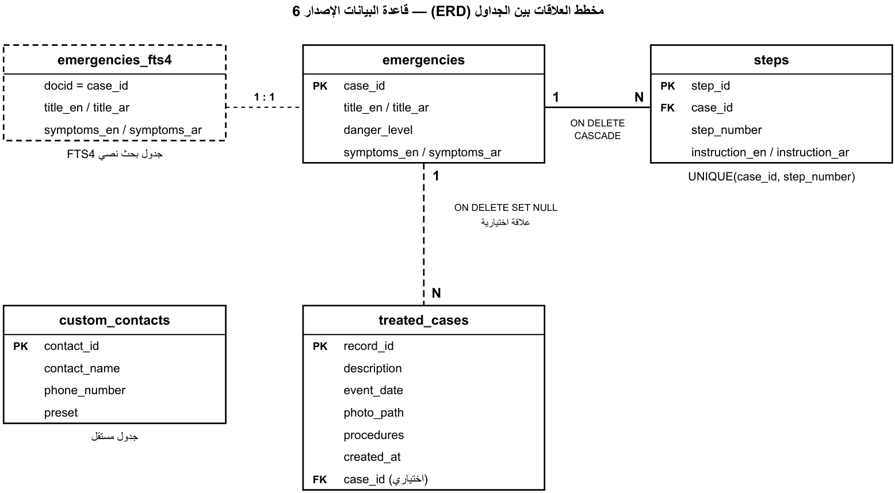

### 2.1 الجداول

**جدول الحالات الإسعافية `emergencies`:**

| العمود | النوع والقيود | المعنى | الاسم في الوظيفة |
|---|---|---|---|
| `case_id` | `INTEGER PRIMARY KEY` | رقم الحالة | `case_id` |
| `title_en` / `title_ar` | `TEXT NOT NULL` | عنوان الحالة بالإنجليزية والعربية | `title` |
| `danger_level` | `TEXT NOT NULL CHECK` (critical / moderate / minor) | مستوى الخطورة: حرج، متوسط، طفيف | `danger_level` |
| `symptoms_en` / `symptoms_ar` | `TEXT NOT NULL` | الأعراض المصاحبة باللغتين | `symptoms` |

**جدول خطوات الإسعاف `steps`:**

| العمود | النوع والقيود | المعنى | الاسم في الوظيفة |
|---|---|---|---|
| `step_id` | `INTEGER PRIMARY KEY AUTOINCREMENT` | رقم الخطوة | `step_id` |
| `case_id` | مفتاح أجنبي إلى `emergencies` مع `ON DELETE CASCADE` | الحالة التي تتبع لها الخطوة | `case_id` |
| `step_number` | `INTEGER NOT NULL` | ترتيب الخطوة 1، 2، 3 | `step_number` |
| `instruction_en` / `instruction_ar` | `TEXT NOT NULL` | نص الإجراء الإسعافي باللغتين | `instruction_text` |

**جدول أرقام الطوارئ `custom_contacts`:**

| العمود | النوع والقيود | المعنى |
|---|---|---|
| `contact_id` | `INTEGER PRIMARY KEY AUTOINCREMENT` | رقم السجل |
| `contact_name` | `TEXT NOT NULL` | الاسم |
| `phone_number` | `TEXT NOT NULL` | رقم الهاتف |
| `preset` | `INTEGER DEFAULT 0` | 1 للأرقام العامة (شرطة، إسعاف، إطفاء) التي لا يمكن تعديلها أو حذفها |

**جدول الحالات المعالجة `treated_cases`:**

| العمود | النوع والقيود | المعنى |
|---|---|---|
| `record_id` | `INTEGER PRIMARY KEY AUTOINCREMENT` | رقم السجل |
| `description` | `TEXT NOT NULL` | وصف الحالة |
| `event_date` | `TEXT NOT NULL` بصيغة `YYYY-MM-DD` | تاريخ الحالة |
| `photo_path` | `TEXT` (اختياري) | اسم ملف صورة الحالة المحفوظة داخل التطبيق |
| `procedures` | `TEXT NOT NULL` | الإجراءات التي أُجريت |
| `created_at` | `INTEGER` (تلقائي) | وقت إنشاء السجل |
| `case_id` | مفتاح أجنبي اختياري مع `ON DELETE SET NULL` | نوع الحالة الإسعافية المعالجة |

### 2.2 تبرير العلاقات

- **الحالات ← الخطوات (واحد-إلى-متعدد):** لكل حالة عدة خطوات مرتبة كما تطلب الوظيفة. فصلنا الخطوات في جدول مستقل بدل تخزينها نصاً واحداً، حتى نعرضها قائمة مرقمة ونضمن ترتيبها بالعمود `step_number`. القيد `UNIQUE(case_id, step_number)` يمنع تكرار رقم الخطوة في الحالة نفسها، و`ON DELETE CASCADE` يمنع بقاء خطوات بلا حالة.
- **الحالات ← الحالات المعالجة (واحد-إلى-متعدد اختيارية):** ربطنا كل سجل معالجة بنوع الحالة الإسعافية حتى نستطيع إحصاء الحالات المعالجة حسب الخطورة. جعلنا الربط اختيارياً لأن المستخدم قد يعالج حالة غير موجودة في الدليل. اخترنا `ON DELETE SET NULL` حتى لا تُحذف سجلات المستخدم إذا تغيّر محتوى الدليل.
- **أرقام الطوارئ جدول مستقل:** لا يرتبط بغيره، والعمود `preset` يميّز الأرقام العامة عن أرقام المستخدم.
- **جدول البحث `emergencies_fts4`:** علاقة واحد-إلى-واحد مع الحالات (`docid` يساوي `case_id`)، ويُعاد بناؤه من جدول الحالات.
- **ثنائية اللغة:** قسمنا `title` و `symptoms` و `instruction_text` إلى عمودين (عربي وإنجليزي) لأن التطبيق يدعم اللغتين. هذا توسيع لمخطط الوظيفة دون تغيير معناه.

### 2.3 الفهارس

| الفهرس | الغرض |
|---|---|
| `idx_emergency_severity` على `danger_level` | تسريع التجميع والترتيب حسب الخطورة |
| `idx_treated_date` على `event_date` | تسريع عرض السجل حسب التاريخ |
| `idx_treated_case` على `case_id` | تسريع الربط بين السجل والحالات في القائمة والإحصاءات |

[[PAGEBREAK]]

## 3. بنية المشروع (Architecture)

قسمنا الكود إلى ثلاث حزم بحسب المسؤولية: `core` للإعدادات والترجمة، و`data` للوصول إلى البيانات، و`ui` للواجهات. لا تتعامل أي شاشة مع ملف أو جدول مباشرة، بل عبر فئات الحزمة `data`.

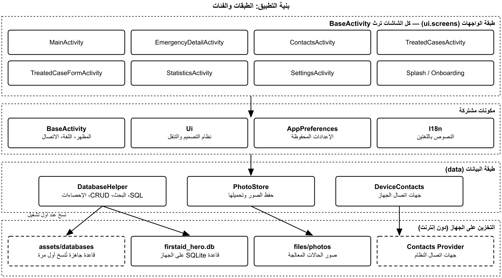

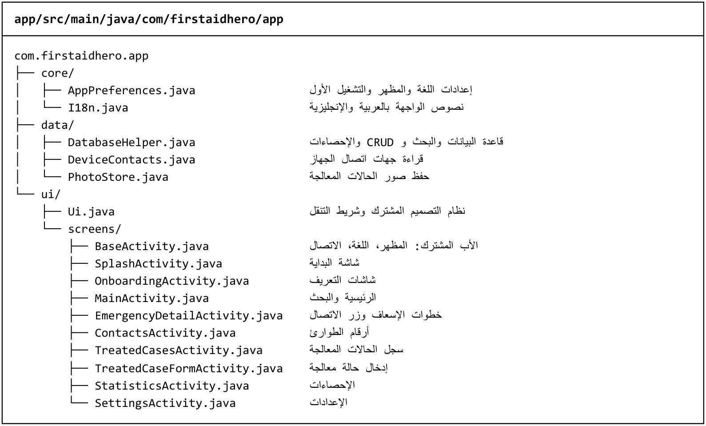

### 3.1 الفئات الرئيسية

| الفئة | المسؤولية |
|---|---|
| `DatabaseHelper` | يرث `SQLiteOpenHelper`: نسخ القاعدة الجاهزة، إنشاء الجداول، الترحيل، البحث، CRUD، والإحصاءات |
| `PhotoStore` | حفظ صور الحالات المعالجة داخل التطبيق وتحميلها بالحجم المناسب |
| `DeviceContacts` | قراءة جهات اتصال الجهاز لاختيار رقم طوارئ منها |
| `AppPreferences` | حفظ اللغة والمظهر وإتمام شاشات التعريف |
| `I18n` | كل نصوص الواجهة بالعربية والإنجليزية |
| `Ui` | نظام التصميم المشترك: الألوان والنصوص والأزرار وهيكل الشاشة وشريط التنقل |
| `BaseActivity` | الأب المشترك لكل الشاشات: المظهر، تحديث اللغة، والاتصال المباشر |
| `MainActivity` | الشاشة الرئيسية والبحث الفوري |
| `EmergencyDetailActivity` | شاشة خطوات الإسعاف وزر الاتصال السريع |
| `ContactsActivity` | شاشة أرقام الطوارئ (إضافة، تعديل، حذف، اتصال) |
| `TreatedCasesActivity` | سجل الحالات المعالجة مع البحث |
| `TreatedCaseFormActivity` | إدخال حالة معالجة وتعديلها مع الصورة |
| `StatisticsActivity` | الإحصاءات حسب الخطورة والتاريخ |
| `SettingsActivity` / `SplashActivity` / `OnboardingActivity` | الإعدادات، شاشة البداية، وشاشات التعريف |

### 3.2 قرارات التصميم

- **بناء الواجهات برمجياً بلغة Java عبر الفئة `Ui`:** يضمن أن تكون كل الشاشات بالشكل نفسه (الألوان، الخطوط، الزوايا، الاتجاه من اليمين لليسار)، ويسهّل دعم الوضع الليلي واللغتين من مكان واحد.
- **شاشة لكل قسم (Activity):** كل تبويب في شريط التنقل السفلي شاشة مستقلة، ويُعاد استخدامها عند الرجوع إليها بالعلم `FLAG_ACTIVITY_REORDER_TO_FRONT`.
- **Adapters و ViewModels:** ذكرتهما الوظيفة أمثلةً على الفئات. لم نستخدمهما لأن حجم البيانات صغير (عشرات السجلات)، فبنينا القوائم مباشرة من نتيجة الاستعلام (`Cursor`) داخل كل شاشة، مع إغلاق المؤشر دائماً في `finally`. هذا أبسط وأسرع لهذا الحجم. إذا كبرت البيانات مستقبلاً يمكن الانتقال إلى `RecyclerView` مع `Adapter`.
- **التوثيق داخل الكود:** وضعنا تعليقاً عربياً فوق كل فئة وكل طريقة وبجانب كل مكتبة مستوردة.

### 3.3 التنقل بين الشاشات

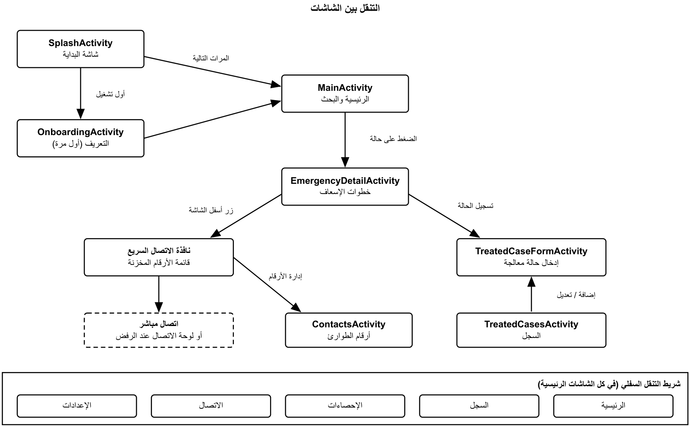

[[PAGEBREAK]]

## 4. تضمين قاعدة البيانات الجاهزة (Pre-populated DB)

تطلب الوظيفة تضمين قاعدة بيانات مسبقة الصنع داخل التطبيق ونسخها من مجلد `assets` عند الإقلاع الأول. نفّذنا ذلك على ثلاث مراحل: توليد ملف القاعدة، شحنه داخل التطبيق، ثم نسخه وفتحه على الجهاز.

### 4.1 توليد ملف القاعدة

بدل إنشاء ملف القاعدة يدوياً، كتبنا سكربت Python يولّده بالكامل: الجداول، الحالات الثماني، الخطوات المرقمة، الأرقام العامة، وفهرس البحث. ميزة ذلك أن أي تعديل على المحتوى يُعاد توليده بأمر واحد، وأن المخطط في السكربت مطابق للمخطط في الكود.

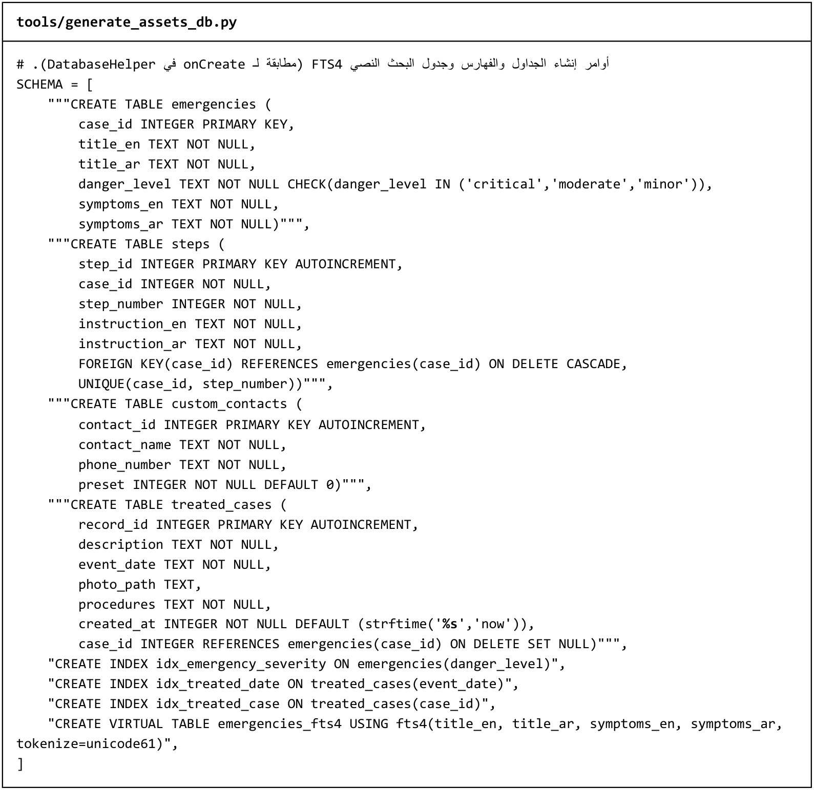

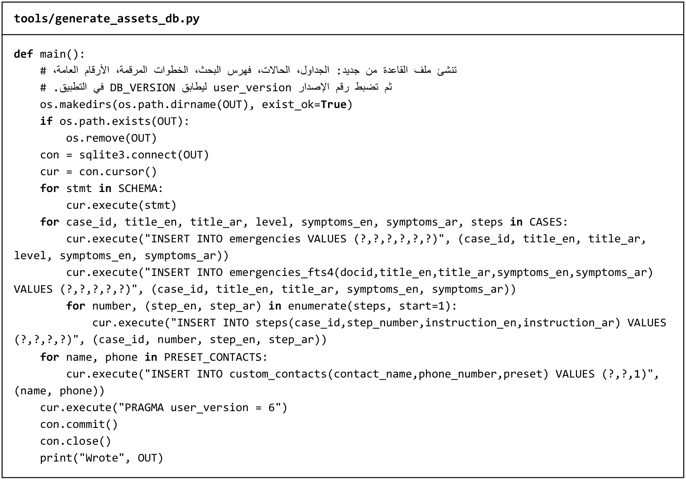

يُحفظ الملف الناتج في `app/src/main/assets/databases/firstaid_hero.db`، فيُضمَّن تلقائياً داخل ملف التطبيق عند البناء. ويضبط السكربت `PRAGMA user_version = 6` ليطابق رقم الإصدار في الكود.

### 4.2 النسخ عند أول تشغيل

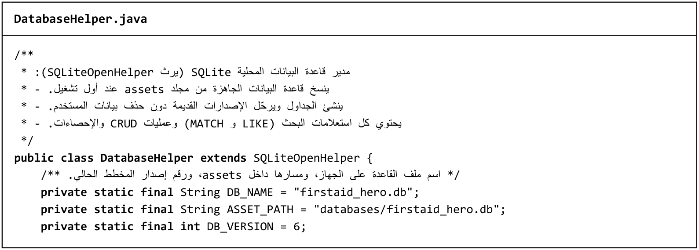

عند فتح أي شاشة يُنشأ كائن `DatabaseHelper`، فيستدعي `copyDatabaseFromAssets()`. إذا لم يكن ملف القاعدة موجوداً على الجهاز، تُنسخ القاعدة الجاهزة من `assets` إلى مسار قواعد بيانات التطبيق على دفعات من 8 كيلوبايت. بعد ذلك تقرأ مكتبة `SQLiteOpenHelper` رقم الإصدار من الملف المنسوخ، فتجده مساوياً لـ `DB_VERSION` ولا تستدعي `onCreate` ولا `onUpgrade`.

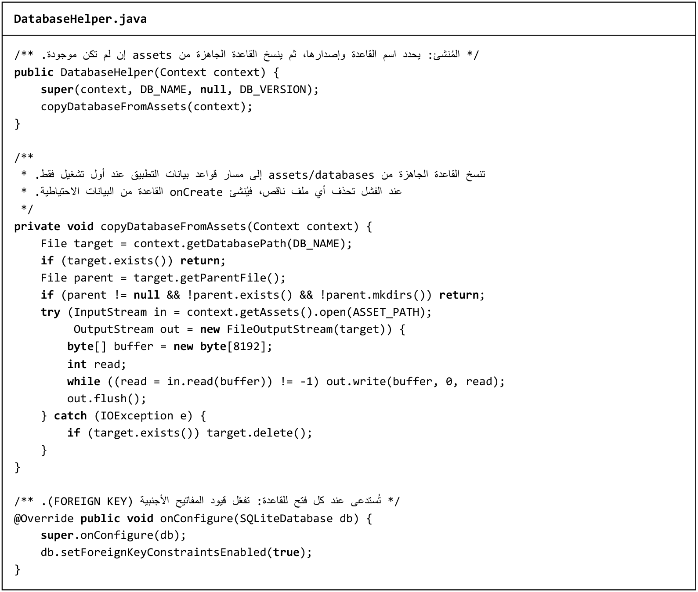

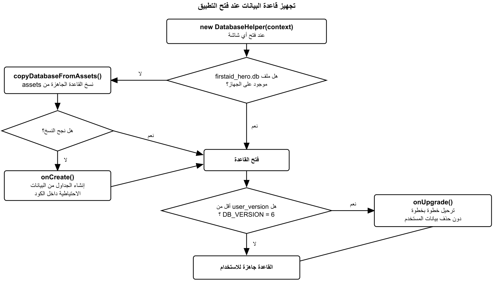

**حماية من الفشل:** إذا تعذّر النسخ (ملف مفقود أو تالف) يحذف الكود أي ملف ناقص، فتُنشئ `onCreate` القاعدة نفسها من نسخة احتياطية من المحتوى موجودة داخل الكود (`SEED_CASES` و `SEED_STEPS`). بذلك لا يفتح المستخدم التطبيق أبداً على قاعدة فارغة.

### 4.3 الإصدارات والترحيل دون فقدان البيانات

مرّت القاعدة بستة إصدارات أثناء التطوير. المستخدم الذي ثبّت إصداراً قديماً لديه بيانات خاصة (أرقام وسجلات وصور) لا يجوز حذفها، لذلك ترحّل `onUpgrade` القاعدة خطوة بخطوة:

| الإصدار | التغيير |
|---|---|
| 1 | المخطط الأول |
| 2 | عمود `preset` لحماية الأرقام العامة |
| 3 | فهرس البحث FTS4 |
| 4 | إصلاح نصوص عربية تالفة في الملف الجاهز |
| 5 | حفظ الصورة كملف داخل التطبيق وربط السجل بنوع الحالة |
| 6 | إضافة حالتي الكسور والجروح البسيطة وتحديث حالة اللدغات |

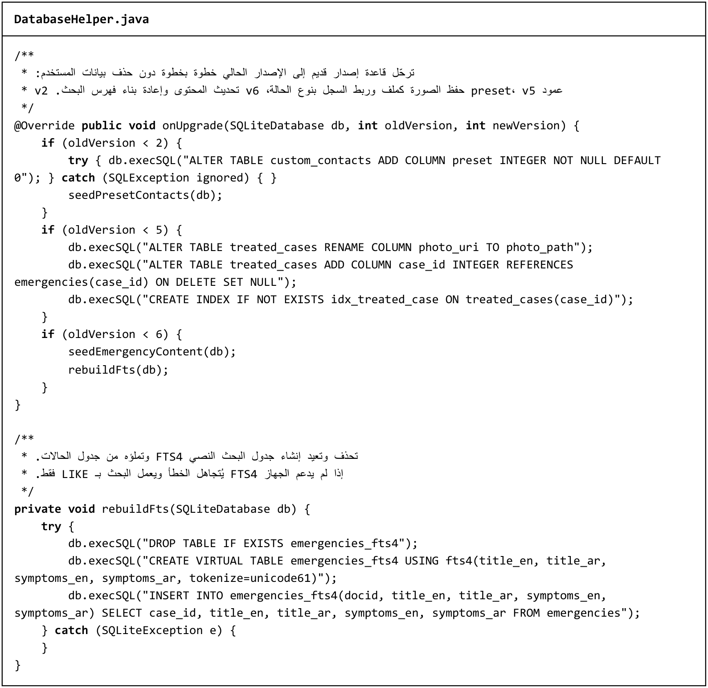

**درس تعلمناه:** في البداية كان تحديث المحتوى يحذف الحالات ثم يعيد إدخالها. اكتشفنا أن الحذف سيقطع روابط السجلات المعالجة بالحالات (بسبب `ON DELETE SET NULL`)، فاستبدلنا ذلك بأمر **UPSERT** يحدّث الحالة الموجودة في مكانها:

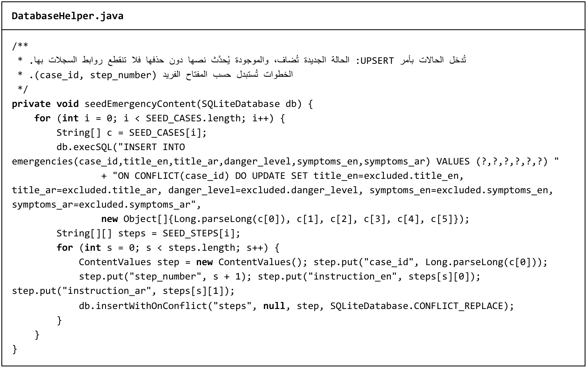

[[PAGEBREAK]]

## 5. استعلامات SQL

### 5.1 البحث الفوري (LIKE و MATCH)

البحث هو أهم وظيفة في التطبيق، لأن المستخدم في حالة طوارئ يكتب كلمة ناقصة ويريد النتيجة فوراً. لذلك يُنفَّذ البحث مع كل حرف يُكتب:

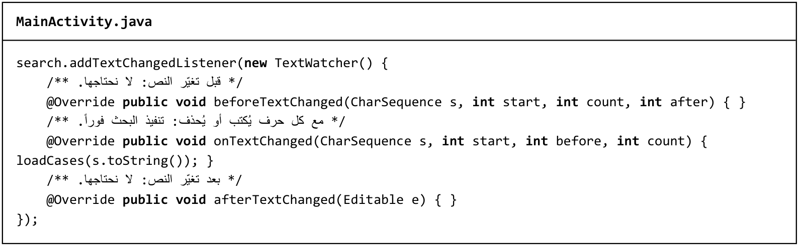

ويجمع الاستعلام طريقتين:

- **`MATCH` على فهرس FTS4:** يبحث ببادئات الكلمات وبأي ترتيب. مثلاً كتابة `sna ins` تجد "Snake or insect bite"، وهي نتيجة لا يجدها `LIKE` وحده.
- **`LIKE` على العناوين والأعراض باللغتين:** يجد أي جزء من الكلمة، مثل "لدغ" داخل "لدغات الأفاعي والحشرات" كما في مثال الوظيفة.

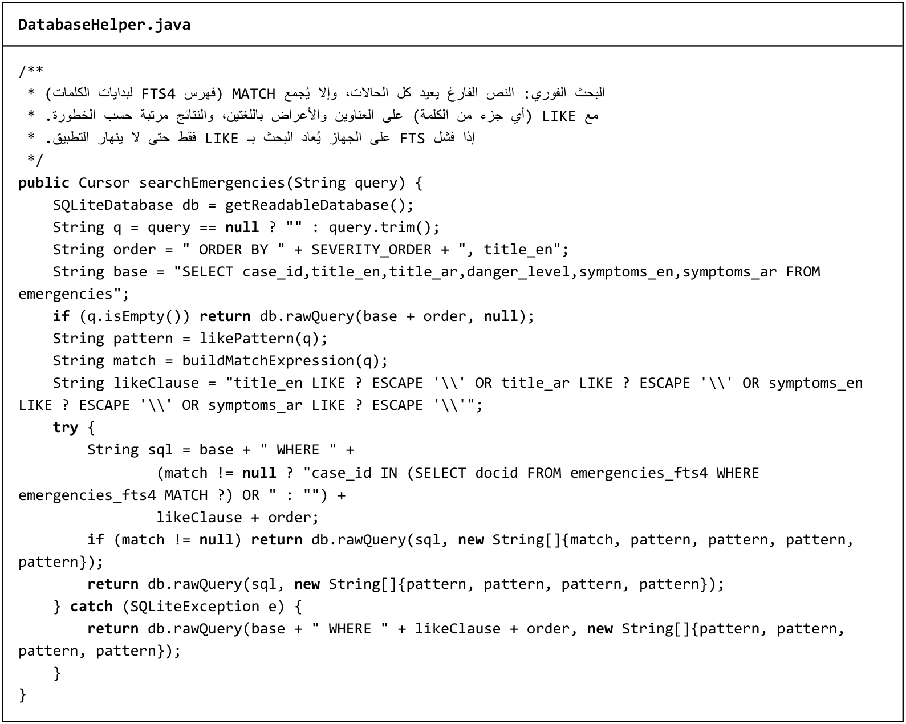

تُرتَّب النتائج حسب الخطورة (حرج ثم متوسط ثم طفيف). إذا لم يدعم الجهاز FTS4 يلتقط الكود الخطأ ويعيد البحث بـ `LIKE` وحده، فلا ينهار التطبيق.

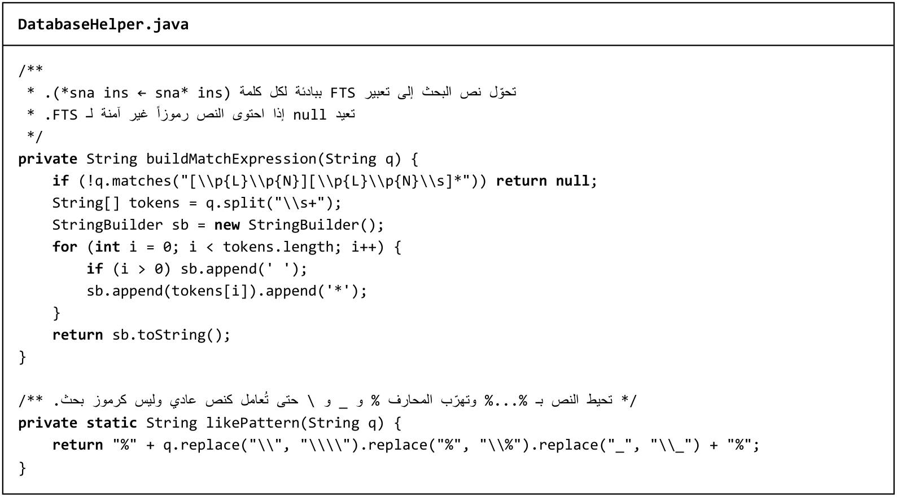

**الأمان:** كل القيم تمرَّر كمعاملات `?` وليس بدمج النص في الاستعلام، فلا مجال لحقن SQL. والدالة `likePattern` تهرّب الرموز `%` و `_` و `\` حتى لا يطابق البحث كل شيء إذا كتبها المستخدم.

### 5.2 التقارير الإحصائية

تطلب الوظيفة شاشة تعرض تصنيف الحالات حسب خطورتها باستعلامات الفرز والمجاميع التكرارية. استخدمنا `GROUP BY` مع `COUNT(*)` و `ORDER BY` حسب الخطورة:

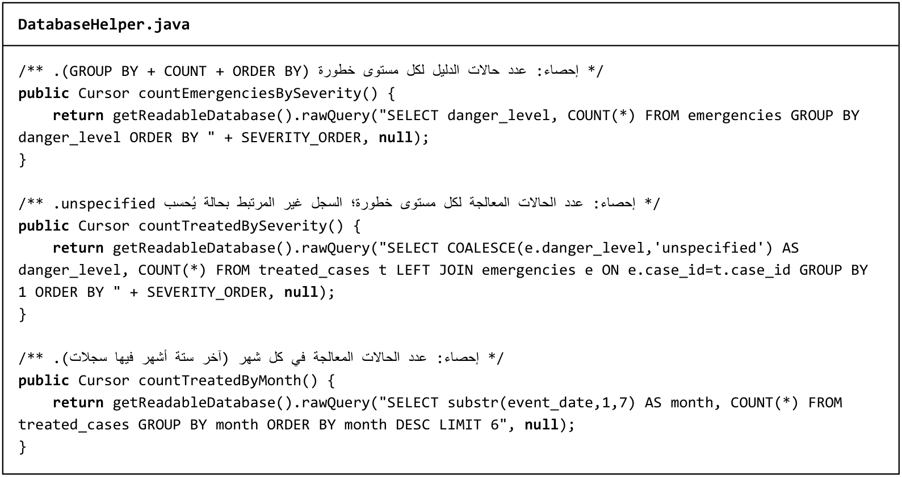

النتيجة على المحتوى الحالي: 4 حالات حرجة، و3 متوسطة، وحالة واحدة طفيفة. وتعرض الشاشة النتائج أشرطةً أفقية:

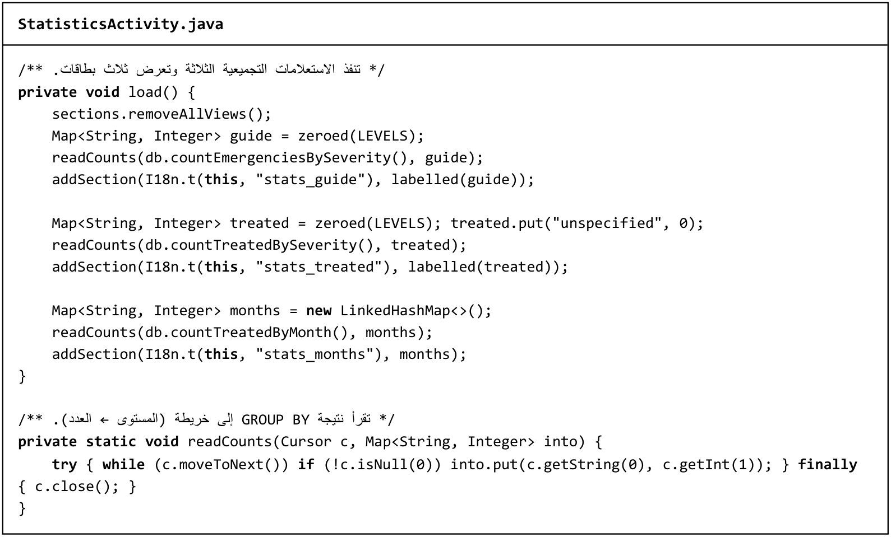

### 5.3 سرعة الاستعلامات

قسنا زمن الاستعلامات الفعلية على القاعدة الجاهزة (200 تنفيذ تمهيدي ثم 20,000 تنفيذ لكل استعلام):

| الاستعلام | النمط | متوسط الزمن | النتائج |
|---|---|---|---|
| بحث فارغ (كل الحالات) | مسح كامل | 130 ميكروثانية | 8 |
| "bur" | MATCH + LIKE | 194 ميكروثانية | 1 |
| "sna ins" | MATCH + LIKE | 205 ميكروثانية | 1 |
| "لدغ" | MATCH + LIKE | 200 ميكروثانية | 1 |
| "كسو" | MATCH + LIKE | 206 ميكروثانية | 1 |
| إحصاء الحالات حسب الخطورة | GROUP BY + COUNT | 116 ميكروثانية | 3 |

كل استعلام أقل من ربع ملّي ثانية، فالبحث فوري فعلاً ويمكن تنفيذه مع كل ضغطة مفتاح دون أي تأخير.

## 6. عمليات CRUD

| البيانات | إضافة / تعديل | قراءة | حذف |
|---|---|---|---|
| الحالات والخطوات | محتوى جاهز للقراءة فقط | `searchEmergencies`، `getEmergency`، `getSteps` | — |
| أرقام الطوارئ | `saveContact` | `getContacts` | `deleteContact` |
| الحالات المعالجة | `saveTreatedCase` | `getTreatedCase`، `getTreatedCases` | `deleteTreatedCase` |

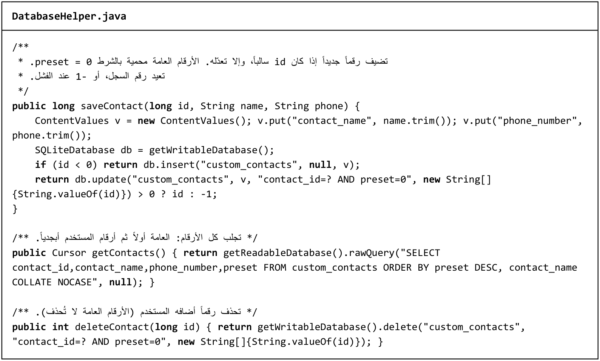

الأرقام العامة محمية من التعديل والحذف بالشرط `preset = 0` داخل الاستعلام نفسه، وليس في الواجهة فقط.

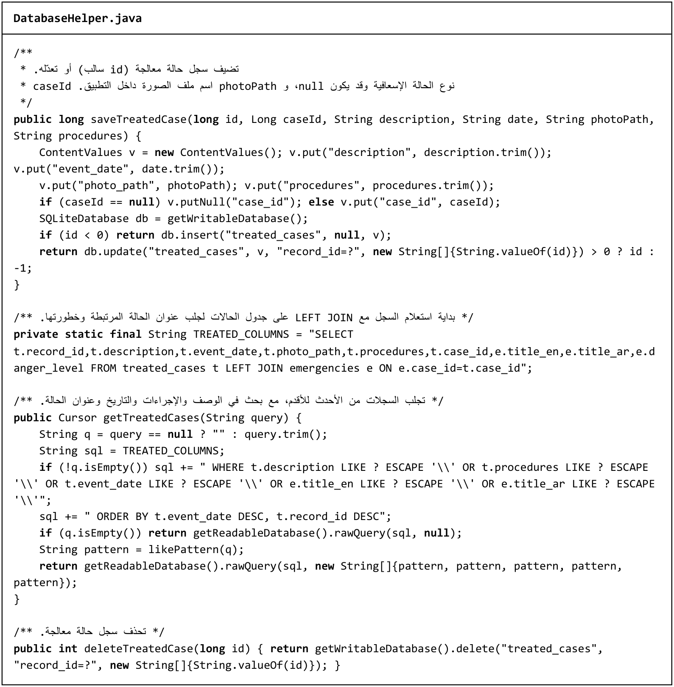

## 7. صورة الحالة المعالجة

تطلب الوظيفة حفظ صورة للحالة المعالجة. فكرنا في حلين: تخزين الصورة داخل القاعدة (BLOB)، أو نسخها إلى ملف داخل التطبيق وتخزين اسمه فقط. اخترنا الحل الثاني لأن أندرويد يقرأ الصف الواحد من القاعدة بحد أقصى نحو 2 ميغابايت، ولأن الصور الكبيرة داخل القاعدة تبطئ كل استعلام على القائمة.

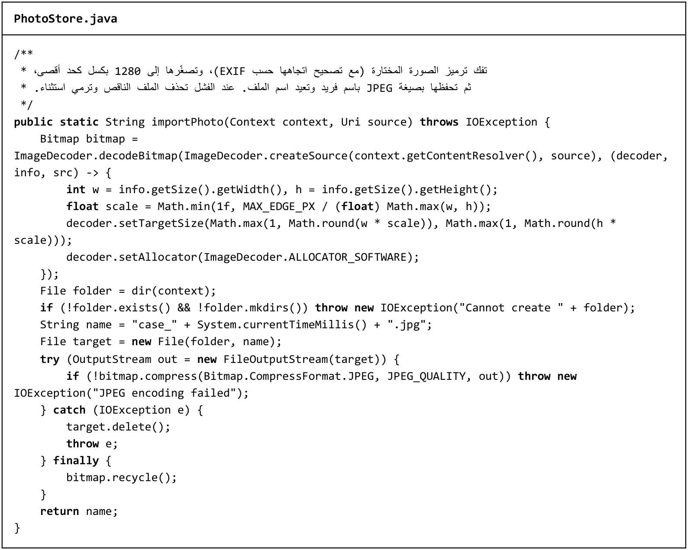

تُصغَّر الصورة إلى 1280 بكسل كحد أقصى مع تصحيح اتجاهها، وتُحفظ في `files/photos/`، فتبقى متاحة دون إنترنت حتى لو حُذفت من معرض الصور. وتتم المعالجة في خيط خلفي حتى لا تتجمد الواجهة، وتُحذف الصور غير المحفوظة عند الخروج من النموذج:

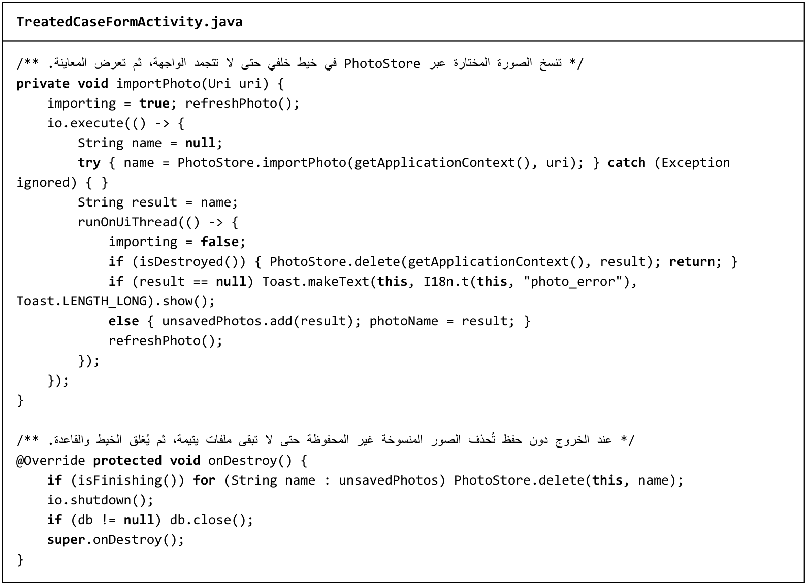

## 8. الاتصال المباشر والصلاحيات

تطلب الوظيفة تفعيل الاتصال المباشر من التطبيق. وضعنا طريقة الاتصال في الشاشة الأب `BaseActivity` حتى تستخدمها كل الشاشات:

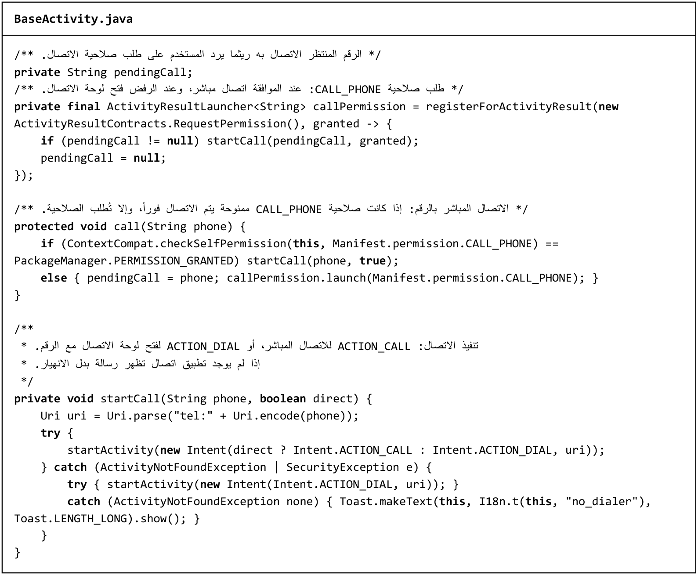

وفي أسفل شاشة الخطوات زر ثابت يعرض الأرقام المخزنة محلياً ويتصل بالرقم المختار مباشرة، كما في سيناريو الوظيفة:

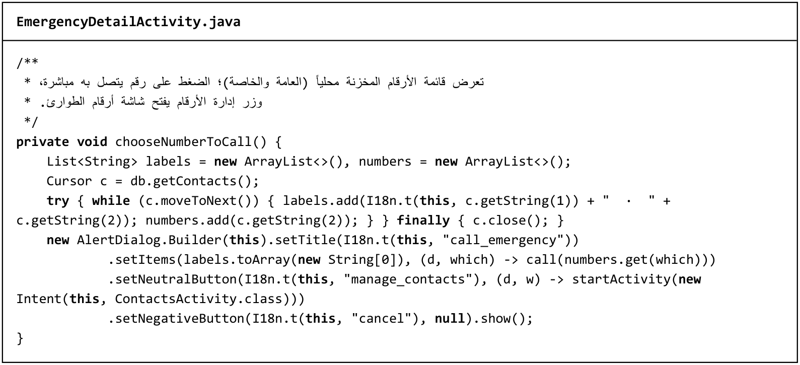

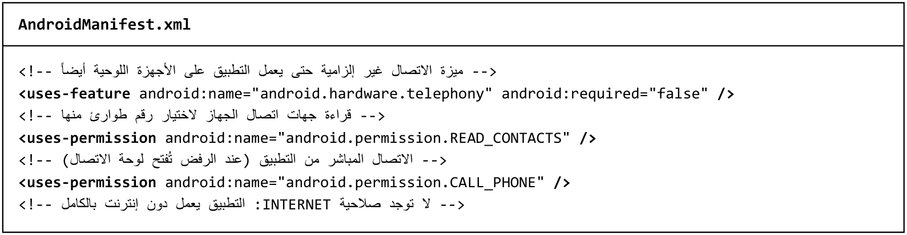

| الصلاحية | الاستخدام | عند الرفض |
|---|---|---|
| `READ_CONTACTS` | اختيار رقم من جهات اتصال الجهاز | يُفتح منتقي النظام الذي لا يحتاج صلاحية |
| `CALL_PHONE` | الاتصال المباشر | تُفتح لوحة الاتصال مع الرقم جاهزاً |

ملاحظة: نظام أندرويد نفسه يحوّل الاتصال بأرقام الطوارئ الرسمية (مثل 112) إلى لوحة الاتصال لمنع الاتصال الخاطئ، والاتصال المباشر يعمل مع الأرقام الخاصة.

## 9. معالجة الأخطاء والتحقق من المدخلات

| الموضع | ما نتحقق منه |
|---|---|
| نموذج رقم الطوارئ | الاسم مطلوب؛ الرقم يقبل الأرقام و `+ ( ) -` والمسافة فقط وبحد أدنى 3 أرقام؛ الخطأ يظهر بجانب الحقل والنافذة تبقى مفتوحة |
| نموذج الحالة المعالجة | الوصف والإجراءات مطلوبة؛ التاريخ بصيغة صحيحة وغير مستقبلي؛ حد أقصى لطول النصوص؛ لا حفظ أثناء معالجة الصورة |
| البحث | تهريب رموز `LIKE`، معاملات `?`، ورجوع إلى `LIKE` إذا فشل FTS |
| الصور | صورة غير قابلة للقراءة أو ملف مفقود ← رسالة بدل الانهيار |
| الاتصال | رفض الصلاحية ← لوحة الاتصال؛ عدم وجود تطبيق اتصال ← رسالة |
| قاعدة البيانات | قيود `NOT NULL` و `CHECK` و `UNIQUE` والمفاتيح الأجنبية مفعّلة |
| تدوير الشاشة | حفظ كل حقول النموذج والصورة واسترجاعها |

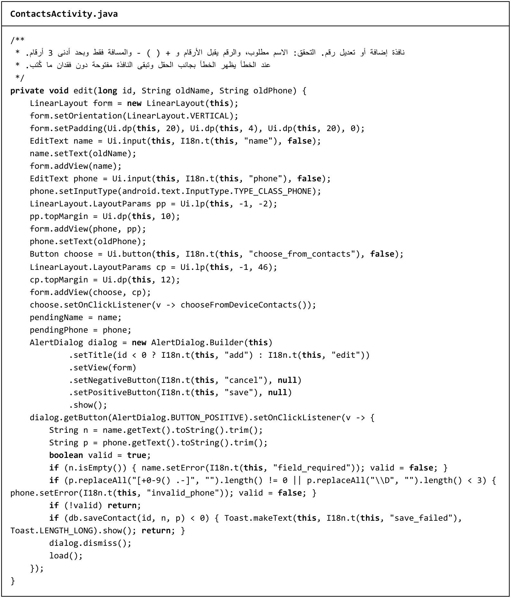

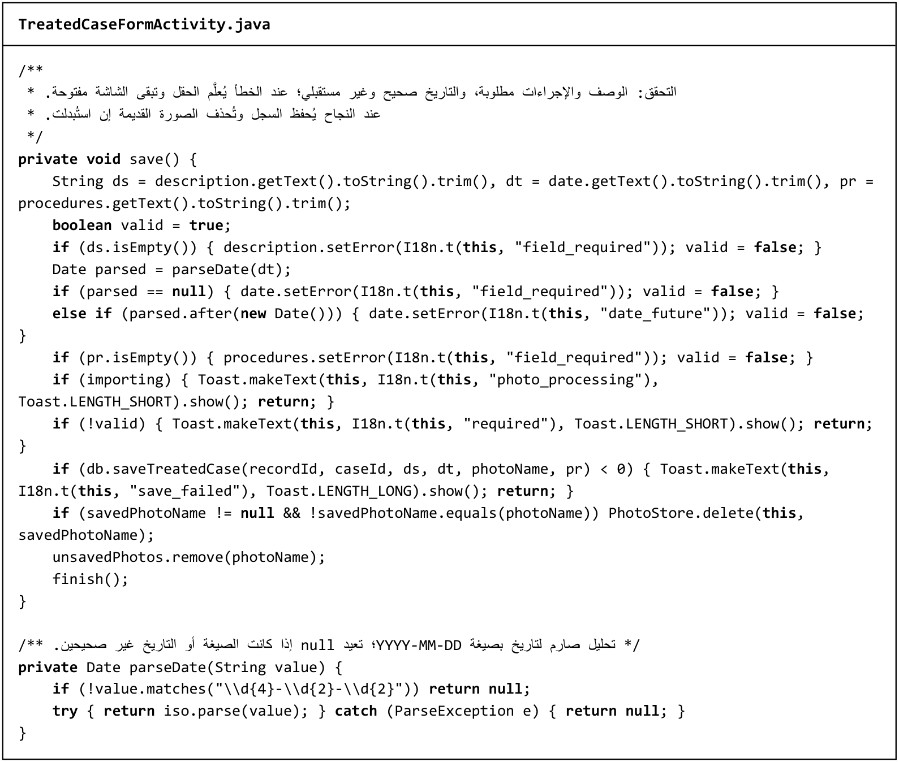

[[PAGEBREAK]]

## 10. المشاكل البرمجية التي واجهتنا وكيف تغلبنا عليها

نستعرض هنا المشاكل الحقيقية التي واجهتنا أثناء التطوير، مع السبب الذي وصلنا إليه والحل الذي اعتمدناه وما تعلمناه.

### 10.1 انهيار التطبيق مع أول حرف في البحث

**المشكلة:** كان التطبيق يُغلق فور كتابة أي حرف في حقل البحث.
**السبب:** سجل الأخطاء أظهر `no such module: fts5`. كنا قد بنينا فهرس البحث بـ FTS5، لكن SQLite المدمج في أندرويد لا يحتوي FTS5.
**الحل:** انتقلنا إلى FTS4 الموجود في كل أجهزة أندرويد، ووضعنا البحث داخل `try/catch` مع رجوع تلقائي إلى `LIKE` وحده إذا لم يتوفر الفهرس.

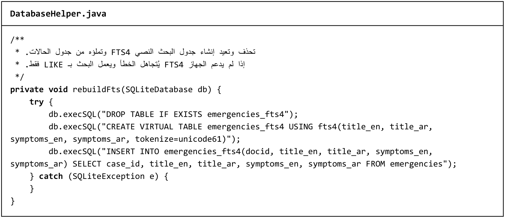

**الدليل على نجاح الحل:** البحث `sna ins` يجد "Snake or insect bite"، وهي نتيجة لا يستطيع `LIKE` إيجادها، أي أن `MATCH` يعمل فعلاً.
**ما تعلمناه:** لا نفترض أن ميزات SQLite على الحاسوب موجودة على الهاتف، ونجعل كل ميزة اختيارية قابلة للرجوع إلى بديل آمن.

### 10.2 البحث بالعربية لا يجد شيئاً

**المشكلة الأولى:** بعد الانتقال إلى FTS4 عمل البحث بالإنجليزية، لكن البحث ببادئة عربية مثل "لدغ" لم يجد نتيجة.
**السبب:** محلّل FTS4 الافتراضي (`simple`) لا يقسّم النص العربي بشكل صحيح.
**الحل:** أنشأنا الجدول بالمحلّل `tokenize=unicode61` الذي يدعم العربية.

**المشكلة الثانية:** ظهرت النصوص العربية في القاعدة الجاهزة رموزاً مشوهة (مثل `ظ†ط²ظٹظپ` بدل "نزيف").
**السبب:** عدّلنا سكربت التوليد بأوامر PowerShell 5.1 التي قرأت الملف بترميز ANSI بدل UTF-8 ثم أعادت كتابته، فتلف كل نص عربي.
**الحل:** أعدنا كتابة السكربت بالنصوص الصحيحة، وأعدنا توليد القاعدة، وأضفنا ترحيلاً يصلح القاعدة عند المستخدمين الحاليين دون حذف بياناتهم.
**ما تعلمناه:** لا نعدّل الملفات التي تحتوي نصوصاً عربية إلا بأدوات تحفظ ترميز UTF-8، ونختبر البحث العربي بعد كل توليد للقاعدة.

### 10.3 شريط التنقل السفلي يميّز التبويب الخطأ

**المشكلة:** بعد التنقل بين التبويبات والرجوع، كان التبويب المميّز لا يطابق الشاشة الظاهرة.
**السبب:** بعد فحص كود مكتبة Material 1.10.0 وجدنا أنها تعكس قيمة الإرجاع من مستمع الاختيار: إرجاع `true` يجعل المكتبة تميّز العنصر المضغوط في شريط الشاشة المغادِرة.
**الحل:** نعيد `true` فقط عند الضغط على تبويب الشاشة الحالية، و `false` عند الانتقال لشاشة أخرى.

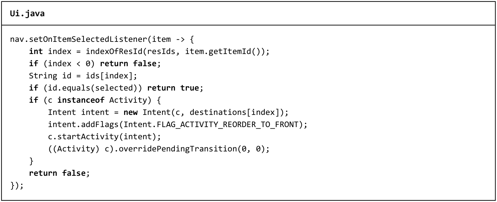

**ما تعلمناه:** عند سلوك غريب في مكتبة جاهزة نقرأ كودها بدل التخمين.

### 10.4 تداخل المحتوى مع أشرطة النظام

**المشكلة:** مع استهداف API 36 يرسم أندرويد الواجهة خلف شريط الحالة وشريط التنقل إجبارياً، فاختفت عناوين الشاشات وشريط التبويبات خلفهما.
**الحل:** الدالة `Ui.edgeToEdge()` تجعل الأشرطة شفافة وتضبط لون أيقوناتها، و `Ui.screen()` تضيف مسافة شريط الحالة أعلى المحتوى ومسافة شريط التنقل أسفل التبويبات.

### 10.5 الوظيفة تطلب قاعدة جاهزة بينما كنا نملأ البيانات من الكود

**المشكلة:** النسخة الأولى كانت تُنشئ البيانات داخل `onCreate` ولا تشحن ملف قاعدة جاهزاً كما تطلب الوظيفة.
**الحل:** سكربت التوليد، ونسخ الملف من `assets` عند أول تشغيل، مع بقاء البيانات داخل الكود كنسخة احتياطية (القسم 4).

### 10.6 صورة الحالة كانت تُحفظ ولا تظهر

**المشكلة:** خزّنت النسخة الأولى رابط الصورة فقط (`content://`). لم تكن الصورة تظهر في أي مكان، وكانت تضيع إذا حذفها المستخدم من المعرض. وكان النموذج نافذة حوار تُغلق عند أي خطأ أو عند تدوير الشاشة، فيضيع ما كُتب.
**الحل:** الفئة `PhotoStore` (القسم 7)، ونقل النموذج إلى شاشة مستقلة فيها معاينة للصورة، وتحقق لا يغلق النموذج، وحفظ لكل الحقول عند تدوير الشاشة، وصورة مصغّرة في السجل.

### 10.7 نموذج رقم الطوارئ يمسح ما كتبه المستخدم

**السبب:** زر الحفظ في نافذة `AlertDialog` يغلقها دائماً، حتى عند وجود خطأ.
**الحل:** ربطنا مستمع زر الحفظ بعد إظهار النافذة عبر `getButton(BUTTON_POSITIVE)`، فلا تُغلق إلا بعد نجاح الحفظ، وتظهر رسالة الخطأ بجانب الحقل.

### 10.8 رموز البحث % و _ تطابق كل شيء

**السبب:** تمرير القيم كمعاملات يمنع حقن SQL، لكنه لا يلغي معنى رموز `LIKE` الخاصة.
**الحل:** الدالة `likePattern` تهرّب هذه الرموز ويُستخدم `ESCAPE` في الاستعلام.

### 10.9 الزوايا الدائرية شبه مربعة على الشاشات عالية الدقة

**السبب:** الدالة `rounded()` كانت تمرر قيمة dp مباشرة كبكسل.
**الحل:** تحويل نصف القطر وسماكة الإطار من dp إلى بكسل حسب كثافة الشاشة.

### 10.10 تثبيت ملف تطبيق قديم أثناء الاختبار

**السبب:** مع إصدار Gradle الجديد (AGP 9) يوجد ملف APK قديم في مجلد `intermediates` بينما الملف الصحيح في `outputs`.
**الحل:** التثبيت دائماً من `app/build/outputs/apk/debug/`.

### 10.11 المسافات بين العناصر في الاتجاه العربي

**المشكلة:** عند التقاط لقطات الشاشة باللغة العربية لاحظنا أن أرقام الخطوات ملتصقة بنص الخطوة، والصور المصغّرة ملتصقة بوصف السجل.
**السبب:** كنا نضع المسافات بـ `leftMargin` و `rightMargin`، وهي جهات ثابتة (يسار ويمين)، فعندما تنقلب الواجهة من اليمين لليسار تصبح المسافة في الجهة الخطأ.
**الحل:** استبدلنا كل المواضع (13 موضعاً) بـ `setMarginStart` و `setMarginEnd` التي تتبع اتجاه القراءة تلقائياً.
**ما تعلمناه:** في تطبيق ثنائي اللغة نستخدم دائماً البداية والنهاية (start/end) بدل اليسار واليمين، ونختبر كل شاشة باللغتين.

### 10.12 فجوات اكتشفناها بمراجعة الوظيفة سطراً بسطر

قبل التسليم راجعنا نص الوظيفة سطراً بسطر، فوجدنا: لا توجد حالة "كسور" مع أن الوظيفة تذكرها، ولا حالة بمستوى "طفيف"، وعنوان حالة اللدغات وترتيب خطواتها يختلفان عن مثال الوظيفة، والزر أسفل شاشة الخطوات يفتح شاشة الأرقام فقط بدل الاتصال السريع، والاتصال يفتح لوحة الاتصال فقط، واستعلامات الإحصاء تجمع دون ترتيب. أصلحنا كل ذلك في الإصدار 6 من القاعدة وفي الشاشات المعنية.
**ما تعلمناه:** مراجعة المتطلبات حرفياً في النهاية تكشف فجوات لا تظهر أثناء البرمجة.

## 11. الاختبار

| الاختبار | النتيجة المتوقعة |
|---|---|
| تشغيل التطبيق مع إيقاف الإنترنت | كل الشاشات تعمل |
| كتابة "لدغ" في البحث | تظهر "لدغات الأفاعي والحشرات" |
| كتابة `sna ins` | تظهر "Snake or insect bite" عبر `MATCH` |
| كتابة `%` في البحث | لا تظهر كل الحالات |
| فتح حالة | خطوات مرقمة بخط كبير وزر اتصال ثابت أسفل الشاشة |
| إضافة رقم برقم خاطئ مثل `abc` | رسالة خطأ بجانب الحقل والنافذة تبقى مفتوحة |
| محاولة تعديل رقم عام | غير ممكن |
| حالة معالجة دون وصف أو بتاريخ مستقبلي | رسالة خطأ ولا يُغلق النموذج |
| تسجيل حالة مع صورة ثم تدوير الشاشة | لا يضيع شيء |
| حذف سجل | يُحذف السجل وملف صورته |
| شاشة الإحصاءات | 4 حرجة، 3 متوسطة، 1 طفيفة لحالات الدليل |
| ترقية من إصدار قديم للقاعدة | تبقى أرقام المستخدم وسجلاته |

[[PAGEBREAK]]

# القسم الثاني: دليل المستخدم والمستثمر (User / Investor Guide)

## 1. دليل التشغيل (User Manual)

### 1.1 التثبيت والتشغيل

1. يُثبَّت التطبيق على أي جهاز أندرويد 11 أو أحدث.
2. لا يحتاج التطبيق إنترنت ولا إنشاء حساب.
3. عند أول تشغيل تظهر شاشة البداية ثم ثلاث صفحات تعريفية يمكن تخطيها.

[[SHOT:01_splash|شاشة البداية]]

[[SHOT:02_onboarding|إحدى صفحات التعريف عند أول تشغيل]]

### 1.2 البحث عن حالة طارئة

1. في الشاشة الرئيسية شريط بحث كبير، وتحته قائمة بكل الحالات مرتبة من الأخطر إلى الأقل خطورة.
2. اكتب أي جزء من اسم الحالة أو أعراضها، بالعربية أو الإنجليزية، فتتحدث النتائج مع كل حرف.
3. اضغط على الحالة لفتح خطواتها.

[[SHOT:03_home|الشاشة الرئيسية وقائمة الحالات]]

[[SHOT:04_search_ldg|البحث بكلمة "لدغ" يُظهر حالة لدغات الأفاعي والحشرات فوراً]]

### 1.3 اتباع خطوات الإسعاف والاتصال السريع

1. تعرض الشاشة عنوان الحالة ومستوى خطورتها والأعراض، ثم الخطوات مرقمة بخط كبير.
2. في أسفل الشاشة زر أحمر ثابت "اتصال سريع بأرقام الطوارئ".
3. اضغط الزر واختر الرقم فيتم الاتصال مباشرة.
4. زر "تسجيل هذه الحالة كمعالجة" يفتح نموذج السجل مع اختيار نوع الحالة تلقائياً.

[[SHOT:05_steps|شاشة خطوات الإسعاف مع زر الاتصال الثابت أسفل الشاشة]]

[[SHOT:06_quick_call|قائمة الأرقام المخزنة للاتصال السريع]]

### 1.4 إضافة رقم طوارئ جديد

1. من شريط التنقل السفلي اختر "الاتصال".
2. في الأعلى الأرقام العامة (الشرطة، الإسعاف، الإطفاء)، والضغط على أي منها يتصل مباشرة.
3. اضغط "إضافة جهة اتصال"، واكتب الاسم والرقم (مثل رقم طبيب العائلة)، أو اضغط "اختيار من جهات اتصال الجهاز".
4. اضغط "حفظ". لكل رقم خاص أزرار للاتصال والتعديل والحذف.

[[SHOT:07_contacts|شاشة أرقام الطوارئ]]

[[SHOT:08_add_contact|إضافة رقم طوارئ جديد]]

[[SHOT:09_contact_error|رسالة خطأ عند إدخال رقم غير صحيح، والنافذة تبقى مفتوحة]]

### 1.5 تسجيل حالة معالجة

1. من "السجل" اضغط "تسجيل حالة معالجة"، أو من شاشة الخطوات اضغط "تسجيل هذه الحالة كمعالجة".
2. اختر نوع الحالة، واكتب الوصف، واختر التاريخ من التقويم، واكتب الإجراءات التي أُجريت.
3. اضغط "اختيار صورة" لإرفاق صورة للحالة، فتظهر معاينتها مباشرة.
4. اضغط "حفظ".

[[SHOT:11_form|نموذج تسجيل حالة معالجة مع معاينة الصورة]]

[[SHOT:10_records|سجل الحالات المعالجة مرتباً حسب التاريخ مع البحث]]

### 1.6 الإحصاءات والإعدادات

- شاشة "الإحصاءات" تعرض عدد الحالات حسب الخطورة، وعدد الحالات المعالجة حسب الخطورة وحسب الشهر.
- شاشة "الإعدادات" لاختيار اللغة (العربية أو English) والمظهر (حسب الجهاز، فاتح، داكن).

[[SHOT:12_statistics|شاشة الإحصاءات]]

[[SHOT:13_settings|شاشة الإعدادات]]

[[PAGEBREAK]]

## 2. فلسفة تجربة المستخدم (UI/UX Justification)

صممنا الواجهة لشخص متوتر يده ترتجف، في مكان قد يكون مظلماً أو مزدحماً، ولا وقت لديه لقراءة قوائم طويلة. كل قرار في التصميم يخدم هذه الحالة:

| القرار | السبب |
|---|---|
| **اللون الأحمر** للبطاقة الرئيسية وأزرار الاتصال وأرقام الخطوات | الأحمر مرتبط في ذهن الناس بالطوارئ والإسعاف، ويجذب العين مباشرة إلى العناصر الأهم |
| **الرمادي الداكن والأبيض** لبقية الواجهة | تباين عالٍ يجعل النص مقروءاً، ولا يشتت الانتباه عن العناصر الحمراء |
| **خط كبير للخطوات** (19sp) وأرقام في دوائر | القراءة تحت الضغط أصعب؛ الخط الكبير والأرقام الواضحة تقلل الأخطاء وتحافظ على ترتيب الخطوات |
| **شريط بحث كبير في أعلى الشاشة الرئيسية** | المستخدم يصل إلى الحالة بكلمة واحدة دون تصفح قوائم |
| **بحث بجزء من الكلمة وبالعربية والإنجليزية** | المستخدم المتوتر يكتب كلمة ناقصة أو بلغة غير متوقعة |
| **ترتيب النتائج حسب الخطورة** | الحالات المهددة للحياة تظهر أولاً |
| **زر اتصال ثابت أسفل شاشة الخطوات** | لا يختفي مع التمرير، وفي متناول الإبهام؛ ضغطتان تكفيان للاتصال |
| **عمل كامل دون إنترنت** | الحوادث تقع غالباً في أماكن بلا تغطية (رحلات، طرق، مناطق نائية) |
| **العربية مع اتجاه من اليمين لليسار** | اللغة الأم للمستخدمين المستهدفين؛ الفهم أسرع وأدق |
| **الوضع الداكن** | قراءة مريحة ليلاً دون إبهار العين |
| **رسائل الخطأ بجانب الحقل دون إغلاق النموذج** | لا يخسر المستخدم ما كتبه بسبب خطأ صغير |
| **تنبيه طبي واضح** | التطبيق مرجع سريع لا يغني عن الاتصال بخدمات الطوارئ |

## 3. جدوى المشروع (Value Proposition)

### 3.1 المشكلة

في الدقائق الأولى بعد الحادث يكون الشخص الموجود في المكان هو المسعف الوحيد. معظم الناس لا يتذكرون خطوات الإسعاف الصحيحة تحت الضغط، والبحث في الإنترنت بطيء أو غير ممكن في أماكن كثيرة، وقد يقود إلى معلومات غير موثوقة.

### 3.2 الحل

تطبيق صغير يعمل دون إنترنت، يعطي الخطوات الصحيحة مرتبة في ثوانٍ، ويربط المستخدم بأرقام الطوارئ بضغطتين، ويحفظ سجلاً للحالات التي عولجت مع صورها.

### 3.3 كيف ينقذ الأرواح

- **السرعة:** البحث يعيد النتيجة في أقل من ربع ملّي ثانية، والخطوات على بعد ضغطة واحدة.
- **الصحة:** خطوات مرتبة وواضحة تقلل الأخطاء الشائعة، مثل مص السم من اللدغة أو تقويم الكسر.
- **الاتصال المبكر:** زر الاتصال الثابت يقلل الوقت حتى طلب المساعدة المختصة.

### 3.4 الفئات المستهدفة

| الفئة | القيمة |
|---|---|
| المدارس | مرجع إسعاف للمعلمين والمشرفين، وسجل للحالات التي عولجت مع صورها |
| السلامة المهنية في المصانع ومواقع البناء | استجابة أسرع لإصابات العمل وتوثيقها |
| الرحلات والأنشطة الخارجية والكشافة | يعمل في الأماكن التي لا تصلها شبكة |
| الأسر | مرجع منزلي لحوادث الأطفال والمسنين |

### 3.5 الجدوى الاقتصادية

- **تكلفة تشغيل شبه معدومة:** لا يوجد خادم ولا قاعدة بيانات سحابية ولا اشتراكات، فكل البيانات على جهاز المستخدم. تكلفة إضافة مستخدم جديد صفر.
- **لا مخاطر على الخصوصية:** بيانات المستخدم (أرقامه وصور الحالات) لا تغادر جهازه.
- **سهولة التوسع:** إضافة حالات جديدة أو لغة جديدة تتم بتحديث ملف القاعدة الجاهزة ورفع رقم الإصدار، دون تغيير في بنية التطبيق.
- **نماذج تمويل ممكنة:** ترخيص نسخ مخصصة للمدارس والشركات (بأرقامها الداخلية وشعارها)، أو رعاية من جهات صحية ومنظمات إغاثة، أو تطبيق مجاني للجمهور بدعم من جهة السلامة العامة.

### 3.6 الحدود والمخاطر

- محتوى الإسعافات إرشادي عام ويجب أن تراجعه جهة طبية محلية قبل النشر العام.
- أرقام الطوارئ العامة يجب التأكد منها لكل بلد.
- التطبيق لا يغني عن خدمات الطوارئ، ويعرض ذلك بوضوح للمستخدم.

[[PAGEBREAK]]

# الخاتمة والتأمل

خرجنا من هذا المشروع بعدة دروس عملية:

- **المتطلب الحرفي مهم:** مراجعة نص الوظيفة سطراً بسطر في النهاية كشفت فجوات حقيقية (حالة الكسور، مستوى الخطورة الطفيف، الاتصال المباشر، زر الاتصال أسفل الشاشة) لم تظهر أثناء البرمجة.
- **قاعدة البيانات تعيش أطول من الكود:** كل تغيير في المخطط يحتاج ترحيلاً يحافظ على بيانات المستخدم، وطريقة تحديث المحتوى (UPSERT بدل الحذف) تؤثر على سلامة العلاقات.
- **الأجهزة ليست كالحاسوب:** ما يعمل في SQLite على الحاسوب (FTS5) قد لا يكون موجوداً على الهاتف، لذلك نبني دائماً طريقاً بديلاً آمناً.
- **النص العربي يحتاج عناية خاصة:** في الترميز (UTF-8) وفي البحث (محلّل `unicode61`) وفي العرض (الاتجاه من اليمين لليسار).
- **تجربة المستخدم في الطوارئ مختلفة:** كل ضغطة إضافية وكل نص صغير له ثمن، فصممنا كل شاشة لتختصر الطريق إلى الخطوة التالية.

**تطويرات مستقبلية:** مراجعة طبية للمحتوى وتوسيعه ليشمل حالات أكثر (الصرع، التسمم، ضربة الشمس)، وإضافة رسوم توضيحية للخطوات، والتقاط صورة الحالة بالكاميرا مباشرة، والانتقال إلى `RecyclerView` إذا كبر حجم البيانات، وكتابة اختبارات آلية لقاعدة البيانات والواجهات.

# ملحق: ملفات المشروع

| المسار | المحتوى |
|---|---|
| `app/src/main/java/com/firstaidhero/app/` | كود Java للتطبيق مع تعليقات عربية |
| `app/src/main/assets/databases/firstaid_hero.db` | قاعدة البيانات الجاهزة (الإصدار 6) |
| `app/src/main/AndroidManifest.xml` | الشاشات والصلاحيات |
| `tools/generate_assets_db.py` | سكربت توليد قاعدة البيانات الجاهزة |
| `docs/FULL_PROJECT_GUIDE_AR.md` | الدليل الشامل للمشروع بالعربية |
| `docs/CODE_AND_METHODS_AR.md` | شرح كل فئة وطريقة وقاعدة البيانات |
| `docs/CHECKLIST_AR.md` | مطابقة متطلبات الوظيفة سطراً بسطر |
